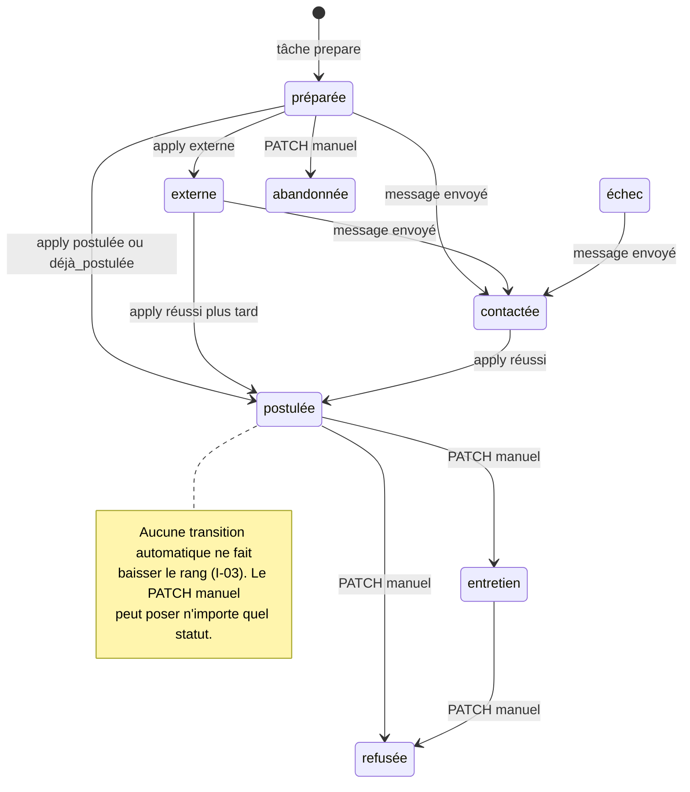

# Contexte Métier & Règles Système - Backend

> **Périmètre** : backend Python de `linkedin_market` (paquet `linkedin_market/`, API FastAPI sous `web/`).
> **Source de vérité** : `docs/context/schemas-architecture/00` à `04` (lot 1). Les identifiants du glossaire,
> les invariants **I-01…I-16** et les risques **R-1…R-8** y sont définis ; ce document précise **où et comment**
> le backend les applique.
> **Marqueurs** : `[ACTUEL]` = vérifié dans le code ; `[CIBLE]` = décidé, non implémenté (PostgreSQL 18,
> sources France Travail / Malt / WTTJ / Indeed, popup de risques, liste d'opposition).
>
> **Modèle de déploiement** : une instance = un utilisateur, sur son poste. Il n'y a ni organisation ni
> *tenant* : l'isolation se fait par la machine. La colonne `user_id` (I-01) existe en cible pour garder un modèle
> propre et permettre l'import/export, pas pour un mode SaaS (exclu).

## 1. Concepts Métier du Domaine (Core Domain Entities)

### Tâche (`Task` / `tasks`)
- **Définition** : exécution asynchrone d'une action longue ou pilotant le navigateur. Seul moyen pour l'API de
  déclencher une collecte, une préparation, une candidature, une recherche de contacts ou un envoi.
- **Types (`kind`)** : `run`, `rescore`, `train`, `prepare`, `apply`, `contacts`, `message`, `import_profile`,
  `profile_skill` (cf. `05-queues-and-integrations.md` § 1.3).
- **Cycle de vie** : `en_attente → en_cours ⇄ attente_saisie | attente_verification_manuelle → terminée | échec | annulée`
  (constantes `PENDING…CANCELLED` de `web/tasks.py`). Finaux : `terminée`, `échec`, `annulée` (`FINAL`).
- **Appartenance** : `[ACTUEL]` en mémoire dans `TaskManager._tasks`, états finaux ajoutés à `tasks.jsonl`.
  `[CIBLE]` table `tasks` (`user_id NOT NULL`).
- **Identifiant** : `uuid.uuid4().hex[:12]` (12 caractères hexadécimaux) `[ACTUEL]` ; `uuid` (uuidv7) `[CIBLE]`.

### Élément collecté (`Item` / `collected_items`) et Offre (`Item(kind="job")`)
- **Définition** : unité récupérée sur une source. `[ACTUEL]` dataclass `models.Item` dont le champ `source`
  vaut `job`, `post` ou `person` et dont l'`id` est préfixé (`job:4012345678`, `person:<slug>`). `[CIBLE]` ce champ
  devient `kind` et `source_code` désigne la plateforme (cf. ERD § 3).
- **Statuts** : aucun ; un élément est **ajouté** à l'historique (`history.jsonl`, append-only) puis **purgé**
  (`purge_after`, I-10 `[CIBLE]`). La dernière version d'un même `id` gagne à la lecture (`storage.load_items`).
- **Règles** : un profil tiers (`person`) ne conserve que son titre et ses compétences (I-09). `[ACTUEL]` écart :
  `scraper.people()` stocke encore le texte de la carte (`text=_clean(card)`) — à filtrer à l'ingestion.

### Rapport (`reports`)
- **Définition** : instantané d'une analyse (agrégats, offres scorées, modèle, interprétation) en JSON + HTML.
- **Statuts** : aucun ; **immuable** dès l'écriture (I-02). `rescore` et `train` produisent un **nouveau** rapport.
- **Nom** `[ACTUEL]` : `<slug du mot-clé>-AAAAMMJJ-HHMM` (`report.write`, ex. `data-engineer-20261008-1432`).
  Deux rapports produits dans la même minute pour le même mot-clé s'écrasent : violation de I-02, corrigée en
  cible par le suffixe `-n` et la contrainte `UNIQUE (slug)` (cf. ERD).

### Candidature (`applications`) et Dossier de candidature (`Application`)
- **Définition** : suivi d'une offre pour laquelle un dossier a été préparé (`cv.md`, `cv.html`, `message.txt`,
  `conseils.md`, `offre.txt`, `cv.pdf` à la demande) dans `linkedin_market_data/applications/<AAAAMMJJ>-<entreprise>-<titre>/`.
- **Clé** `[ACTUEL]` : l'`id` de l'offre (`job:…`) dans `applications.json`. `[CIBLE]` : `UNIQUE (user_id, item_id)`.
- **Statuts (`status`)** : `préparée`, `contactée`, `postulée`, `entretien`, `refusée`, `abandonnée`, `externe`,
  `échec` (`application.STATUSES`). Rang de progression (`_PROGRESS`, I-03) : `préparée`/`externe`/`échec` = 0,
  `contactée` = 1, `postulée` = 2, `entretien` = 3 ; `refusée` et `abandonnée` ne sont posés que manuellement.
- **État du bot (`apply_state`)** : `''`, `en_cours`, `postulée`, `déjà_postulée`, `incertaine`, `échec`.

Remarque : `advance_status()` accepte toujours une transition depuis `préparée`, `externe` ou `échec` (même vers
un rang égal) ; un message envoyé sur une candidature `postulée` la laisse `postulée` (test
`test_message_does_not_downgrade_a_posted_application`).

### Contact entreprise (`company_contacts`)
- **Définition** : recruteur affiché dans « Rencontrez l'équipe de recrutement » (3 au plus, `contacts.MAX_CONTACTS`)
  ou saisi à la main. `[ACTUEL]` liste `contacts` dans l'entrée de `applications.json`, champs `name`,
  `profile_url`, `email`, `headline`, `source` (`linkedin` ou `manuel`).
- **Règles** : email conservé seulement s'il est **affiché** par LinkedIn (`contacts.extract_email`) ou saisi par
  l'utilisateur ; un email saisi à la main n'est jamais écrasé (`merge_contacts`). Base légale `interet_legitime`
  et purge à 3 ans (I-13, I-14) `[CIBLE]`.
- **Écart de nommage** : le code écrit `source="linkedin"` et `name` ; l'ERD cible attend
  `source="linkedin_equipe_recrutement"` et `full_name`. L'import JSON (`db/import_json.py`) fait la conversion.

### Message de prospection (`outreach_messages`)
- **Définition** : email (SMTP de l'utilisateur) ou message LinkedIn (message direct ou demande de connexion avec
  note ≤ 300 caractères) envoyé à un contact au sujet d'une offre.
- **Statuts** `[CIBLE]` : `confirmé → envoyé | échec`. `[ACTUEL]` aucun objet dédié : l'envoi est tracé par
  `activity.jsonl` (`message_email` / `message_linkedin`) et l'historique de la candidature (`kind="message"`).

### Consentement aux risques (`source_consents`) `[CIBLE]`
- **Définition** : acceptation, pour une source en mode `navigateur` (`linkedin`, `malt`, `wttj`), de la version
  courante du texte de risques (`sources.risk_version`, ex. `2026-10`).
- **Statuts** : actif (`revoked_at IS NULL`) ou révoqué. Un changement de `risk_version` rend le consentement
  existant caduc (I-16) sans le supprimer (preuve).

### Blocage (`activity_events(kind="blocked")`)
- **Définition** : checkpoint, authwall, page de connexion ou `/uas/` détecté pendant une action navigateur (I-06).
- **Effet** : période de repos de **6 h** (`activity.BLOCK_COOLDOWN_HOURS`) pendant laquelle
  `guard_not_blocked()` refuse toute action navigateur ; levée manuelle par `POST /api/block/clear`
  (événement `unblocked`).

### Modèle de matching (`matching_models`)
- **Définition** : régression logistique sur 8 critères (`matching.FEATURES` : `couverture_competences`,
  `similarite_texte`, `similarite_titre`, `seniorite`, `experience`, `teletravail`, `localisation_compatible`,
  `freelance`). Poids *a priori* `PRIOR_WEIGHTS` tant que `MIN_LABELS = 6` annotations des deux classes ne sont
  pas réunies. `[ACTUEL]` `matching_model.json` ; un fichier dont la liste `features` diffère est ignoré.

### Réglages (`user_settings`) et Profil candidat (`candidate_profiles`)
- **Réglages** `[ACTUEL]` `settings.json`, valeurs par défaut `settings.DEFAULT_SETTINGS` ; bornes validées par
  `settings.validate_settings()` (cf. `01-api-contracts.md` § 5.2).
- **Profil** : construit à chaque usage par `pipeline.build_profile()` à partir de `profil.*`/`cv.pdf` à la racine
  ou du cache `linkedin_profile.txt`, puis surcharges `profile_settings.json` appliquées par-dessus — le fichier
  source n'est jamais réécrit.

## 2. Invariants & Règles Métier Strictes

Les invariants sont ceux du lot 1. Ce tableau indique leur **point d'application backend** et leur état réel.

| ID | Point d'application backend | État |
| :--- | :--- | :--- |
| I-01 | Repositories : filtre `user_id` systématique, FK `NOT NULL`. | `[CIBLE]` (fichiers locaux aujourd'hui) |
| I-02 | Aucune route d'écriture sur `/api/reports`. `report.write()` crée un fichier par minute. | `[ACTUEL]` partiel — collision possible dans la même minute ; trigger `BEFORE UPDATE` `[CIBLE]` |
| I-03 | `application.advance_status()` pour toute transition automatique ; `set_status()` réservé à `PATCH /api/applications/{id}`. | `[ACTUEL]` |
| I-04 | Candidature : `TaskContext.ask(..., "confirm_submit", ["Soumettre", "Annuler"], review=…)` dans `apply_bot._steps` ; seule la réponse exacte `Soumettre` clique. Message : `MessageBody.confirm` sinon 422. Les champs `confirm*` ne sont jamais mémorisés (`answer_task`). | `[ACTUEL]` |
| I-05 | `EasyApply._auto_answer()` : `contact_email`, `contact_phone`, `settings.find_answer()` ; tout le reste passe par `ask()`. Cases à cocher jamais cochées. | `[ACTUEL]` |
| I-06 | `activity.guard_not_blocked()` avant chaque action navigateur (routeurs via `require_browser_ready`, services en début de tâche) ; `BlockedError` / `PermissionError` ⇒ `activity.record("blocked", where=…)`. | `[ACTUEL]` partiel — voir écarts § 5 de `05-queues-and-integrations.md` |
| I-07 | `activity.check_quota()` (API **et** début de tâche) ; volumes de collecte = `Caution.max_items`. | `[ACTUEL]` partiel — `max_items` jusqu'à 200 contourne le plafond de prudence ; correction décidée : `max_items` ≤ plafond de la prudence, prudence par défaut `prudent` (cf. écart E-3, `02-business-logic-services.md` § 4) |
| I-08 | Un seul couple `LINKEDIN_EMAIL` / `LINKEDIN_PASSWORD` lu dans `.env` (`config.linkedin_credentials`). | `[ACTUEL]` |
| I-09 | Filtre à l'ingestion de `person` (texte mis à `NULL`, compétences seules). | `[CIBLE]` |
| I-10 | `RetentionService` quotidien (cf. `03-database-and-migrations.md` § 6). | `[CIBLE]` (aujourd'hui seule la fenêtre de lecture de 30 j s'applique) |
| I-11 | `interpreter.interpret()` bascule sur `LocalInterpreter` si Claude est absent ou échoue ; `pipeline.summary_for_interpreter()` n'envoie que des agrégats. | `[ACTUEL]` partiel — `interpreter="none"` produit encore un rapport sans interprétation ; la génération de CV envoie le texte de l'offre à Claude (cf. écart E-6, `02-business-logic-services.md` § 4) |
| I-12 | Gabarit imposé : mention d'origine de l'adresse + désinscription ajoutées par le backend et vérifiées avant envoi. | `[CIBLE]` |
| I-13 | Contrôle `suppression_list` dans la transaction d'envoi ⇒ 409. | `[CIBLE]` |
| I-14 | `company_contacts.purge_after = last_contacted_at + 3 ans`. | `[CIBLE]` |
| I-15 | `.env` hors Git ; `session.json` en `chmod 0o600` `[ACTUEL]` ; cookies chiffrés Fernet en base `[CIBLE]`. TTL 72 h (`SESSION_TTL_HOURS`). | `[ACTUEL]` partiel |
| I-16 | `SourceConsentService.require(source_code)` avant toute tâche `browser=True` sur une source `navigateur` ⇒ 428. | `[CIBLE]` |

Règles complémentaires vérifiées dans le code `[ACTUEL]` :
- **Une seule tâche active par (type, clé)** : `TaskManager.has_active(kind, key)` ⇒ 409 (`run`, `rescore`, `train`,
  `import_profile` globalement ; `prepare`, `apply`, `contacts`, `message` par `job_id` ; `profile_skill` par
  compétence).
- **Une candidature `postulée` ou `entretien` ne peut pas être relancée** dans le bot (409).
- **Le test SMTP ne part que vers soi-même** (`contact_email`, `SMTP_FROM` ou `SMTP_USER`), sinon 422.
- **Les fichiers d'une candidature restent dans `applications/`** (`application.folder_of` ⇒ `ValueError` ⇒ 500).

## 3. Actions & Cas d'Usage Métier (Use-Cases)

### Cas d'Usage : `LancerAnalyse` (`POST /api/runs`)
- **Conditions préalables** :
  - aucune tâche `run` active (sinon 409 « Une analyse est déjà en cours. ») ;
  - mot-clé non vide après fusion avec les réglages (sinon 422) ; `caution`, `max_items`, `interpreter` valides ;
  - si `scrape=true` : identifiants LinkedIn présents (409), aucun blocage dans les 6 h (409) ;
    `[CIBLE]` consentement actif à la version courante pour chaque source `navigateur` demandée (428).
- **Exécution** (tâche `run`, `browser=scrape`) : `pipeline.scrape()` (jobs, posts, profils jusqu'à `max_items`
  chacun, `human_pause` de la prudence) → `pipeline.build_profile()` → `pipeline.analyse()` (fenêtre 30 j,
  TF-IDF, tendances, scoring) → `interpreter.interpret()` → `report.write()`.
  `[CIBLE]` : insertion des éléments en `INSERT … ON CONFLICT (user_id, source_code, kind, external_id) DO UPDATE`
  par lot, puis rapport + événement dans **une** transaction.
- **Effets de bord autorisés** : événement `activity_events(kind="run", keyword, scrape, jobs)` ; en cas de blocage
  `kind="blocked", where="collecte"` ; écriture de `linkedin_profile.txt` si le profil LinkedIn a été lu.

### Cas d'Usage : `PostulerEasyApply` (`POST /api/applications/{job_id}/apply`)
- **Conditions préalables** : candidature existante (404) ; pas déjà `postulée`/`entretien` (409) ; aucune tâche
  `apply` active pour cette offre (409) ; identifiants (409) ; `count_today("apply") < apply_daily_max` (429) ;
  aucun blocage (409) ; `[CIBLE]` consentement `linkedin` (428).
- **Exécution** (tâche `apply`, `browser=True`) : nouveau contrôle de plafond et de blocage dans la tâche,
  génération de `cv.pdf`, `apply_state="en_cours"`, connexion, `EasyApply.run()`, arrêt à l'écran de relecture,
  question `confirm_submit`. Résultat appliqué par `_record_apply_result()` :

  | `ApplyResult.state` | Statut de candidature | `apply_state` | Autres effets |
  | :--- | :--- | :--- | :--- |
  | `postulée` | `advance_status("postulée")` | `postulée` | `activity "apply"`, annotation forcée à 1 |
  | `déjà_postulée` | `advance_status("postulée")` | `déjà_postulée` | — |
  | `externe` | `advance_status("externe")` | `''` | — |
  | `annulée` | inchangé | `''` | — |
  | `incertaine` | inchangé | `incertaine` | l'utilisateur vérifie sur LinkedIn |
  | exception (`ApplyError`, `BlockedError`, délai…) | inchangé | `échec` | `BlockedError` ⇒ `activity "blocked", where="candidature"` |

  Chaque passage ajoute une entrée d'historique `kind="candidature"` (sauf exception).
- **Effets de bord autorisés** : un événement `apply` par candidature réellement soumise (base du plafond).

### Cas d'Usage : `EnvoyerMessage` (`POST /api/applications/{job_id}/messages`)
- **Conditions préalables** : candidature existante (404) ; `confirm=true` (422) ; email : SMTP configuré (503),
  destinataire valide (422), objet non vide sur une ligne (422), plafond `message_daily_max` (429) ; LinkedIn :
  identifiants, plafond, blocage (409/429) ; aucune tâche `message` active pour l'offre (409).
  `[CIBLE]` : destinataire absent de `suppression_list` (409), mention d'origine et de désinscription présentes
  dans le corps (422), consentement `linkedin` pour le canal `linkedin` (428).
- **Exécution transactionnelle** `[CIBLE]` : `BEGIN` → `SELECT … FROM applications WHERE id = :id FOR UPDATE` →
  contrôle d'opposition → comptage du jour → `INSERT outreach_messages(status='confirmé')` → `COMMIT` ; la tâche
  transmet ensuite le message et passe la ligne à `envoyé` ou `échec` (détail dans `03` § 5).
- **Effets de bord autorisés** : `activity_events(kind="message_email"|"message_linkedin", job, to, title)`,
  historique `kind="message"` (canal, destinataire, 120 premiers caractères, mode LinkedIn), statut
  `advance_status("contactée")`, `company_contacts.last_contacted_at` `[CIBLE]`.

### Cas d'Usage : `AccepterRisquesSource` `[CIBLE]` (`POST /api/sources/{code}/consent`)
- **Conditions préalables** : source existante et en mode `navigateur` (404 / 422) ; `risk_version` du corps égale
  à `sources.risk_version` (409 si l'utilisateur a lu une version périmée) ; `accepted=true` (422).
- **Exécution transactionnelle** : révocation du consentement actif éventuel (`revoked_at = now()`) puis insertion
  du nouveau, dans la même transaction (contrainte `UNIQUE (user_id, source_code) WHERE revoked_at IS NULL`).
- **Effets de bord** : aucun appel externe.

### Cas d'Usage : `EnregistrerOpposition` `[CIBLE]` (`POST /api/suppressions`)
- **Conditions préalables** : email ou URL de profil fourni.
- **Exécution transactionnelle** : `INSERT suppression_list(recipient_hash = sha256(normalisé)) ON CONFLICT DO NOTHING`
  puis suppression des emails correspondants dans `company_contacts` (le contact reste sans coordonnée).
- **Effets de bord** : tout envoi ultérieur vers cette adresse ⇒ 409, définitivement (I-13).

### Cas d'Usage : `LeverBlocage` (`POST /api/block/clear`)
- **Conditions préalables** : aucune (action consciente de l'utilisateur après vérification de son compte dans un
  navigateur normal ; l'interface affiche cet avertissement).
- **Exécution** : `activity.record("unblocked")` ; `block_status()` ignore tout `blocked` antérieur.

### Cas d'Usage : `AnnoterOffre` / `EntrainerModele`
- `PUT /api/jobs/{id}/label` : `value ∈ {1, 0, null}` (422 sinon) ; `null` retire l'annotation.
- `POST /api/model/train` : exige une analyse (409) ; la tâche lève `ValueError` « Pas encore assez
  d'annotations (min. 6, des deux types) » si `matching.train_from_labels` renvoie `None` ⇒ tâche `échec`.
  En succès : nouveau modèle `[CIBLE]` `matching_models(version+1, is_active)` puis `rescore` ⇒ nouveau rapport.

## 4. Résultats Finaux Attendus

- **Persistance** :
  - `[ACTUEL]` fichiers JSON/JSONL ; écriture atomique (`tmp` + `os.replace`) **uniquement** pour `settings.json` et
    `profile_settings.json`. `applications.json`, `labels.json`, rapports et `session.json` sont écrits directement
    (risque de fichier tronqué en cas d'arrêt brutal, et de mise à jour perdue entre deux tâches concurrentes).
  - `[CIBLE]` une transaction PostgreSQL par cas d'usage, dates `timestamptz` UTC (`now()`), auteur implicite
    `user_id`, traçabilité par `task_id` dans `activity_events.data` et `application_events`.
- **Idempotence** : pas d'en-tête `Idempotency-Key` (instance mono-utilisateur, aucun client réseau qui rejoue).
  Elle est garantie par :
  - le refus des doublons de tâche (`has_active(kind, key)` ⇒ 409) ;
  - les contraintes `UNIQUE` cibles (`collected_items`, `applications`, `suppression_list`, `source_consents`) et
    `ON CONFLICT DO NOTHING` dans l'import JSON ;
  - l'**absence de relance automatique** de tout envoi (SMTP, message LinkedIn, Easy Apply) : un échec ou un état
    `incertaine` est rendu à l'utilisateur qui vérifie avant de réessayer.
- **Réponse HTTP** : la ressource ou la tâche elle-même, sans enveloppe (`01-api-contracts.md` § 2). Une action
  asynchrone répond `202` + `Task.public()` ; l'état final se lit par `GET /api/tasks/{id}`.
