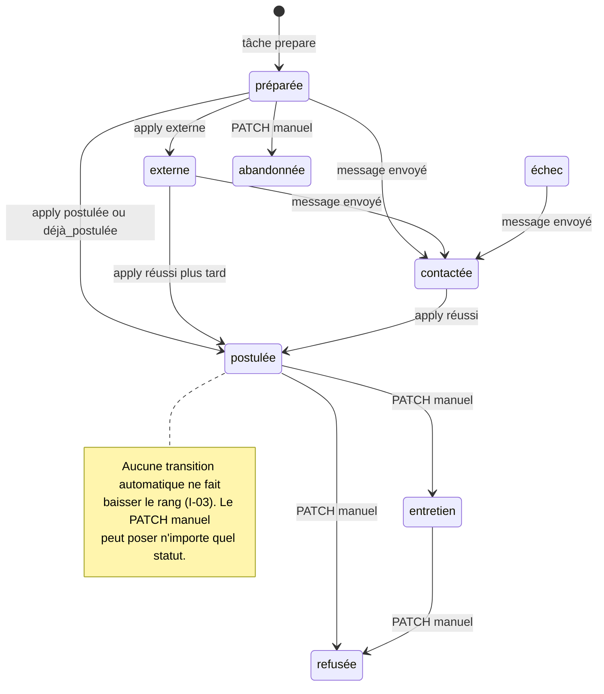

# Contexte Métier & Règles Système - Backend

> **Périmètre** : backend Python de `linkedin_market` (paquet `linkedin_market/`, API FastAPI sous `web/`).
> **Source de vérité** : `docs/context/schemas-architecture/00` à `04` (lot 1). Les identifiants du glossaire,
> les invariants **I-01…I-16** et les risques **R-1…R-8** y sont définis ; ce document précise **où et comment**
> le backend les applique.
> **Marqueurs** : `[ACTUEL]` = vérifié dans le code ; `[CIBLE]` = décidé, non implémenté (sources
> France Travail / Malt / WTTJ / Indeed, popup de risques, liste d'opposition).
>
> **Modèle de déploiement** : une instance = un utilisateur, sur son poste. Il n'y a ni organisation ni
> *tenant* : l'isolation se fait par la machine. La colonne `user_id` (I-01) existe (PostgreSQL 18, vague 1) pour garder un modèle
> propre et permettre l'import/export, pas pour un mode SaaS (exclu).

## 1. Concepts Métier du Domaine (Core Domain Entities)

### Tâche (`Task` / `tasks`)
- **Définition** : exécution asynchrone d'une action longue ou pilotant le navigateur. Seul moyen pour l'API de
  déclencher une collecte, une préparation, une candidature, une recherche de contacts ou un envoi.
- **Types (`kind`)** : `run`, `rescore`, `train`, `prepare`, `apply`, `contacts`, `message`, `import_profile`,
  `profile_skill` (cf. `05-queues-and-integrations.md` § 1.3).
- **Cycle de vie** : `en_attente → en_cours ⇄ attente_saisie | attente_verification_manuelle → terminée | échec | annulée`
  (constantes `PENDING…CANCELLED` de `web/tasks.py`). Finaux : `terminée`, `échec`, `annulée` (`FINAL`).
- **Appartenance** `[ACTUEL]` : table `tasks` (`user_id NOT NULL`) ; l'exécution reste en mémoire
  (`TaskManager`). Au démarrage, les tâches non finales passent en `échec` (« Tâche interrompue par l'arrêt de
  l'application. »). Les anciennes tâches de `tasks.jsonl` sont importées avec un `id` `uuid5` stable.
- **Identifiant** `[ACTUEL]` : UUID v7 généré par Python (`uuid.uuid7()`), chaîne opaque côté API (C-7).

### Élément collecté (`Item` / `collected_items`) et Offre (`Item(kind="job")`)
- **Définition** : unité récupérée sur une source. `[ACTUEL]` dataclass `models.Item` (champ `kind` : `job`,
  `post` ou `person` ; `id` préfixé `job:4012345678`, `person:<slug>`) ; en base `collected_items` avec `kind`,
  `external_id` et `source_code` (plateforme, `linkedin` seule en vague 1). `Item.keyword` = mot-clé demandé à la
  lecture ; la base garde tous les mots-clés de collecte dans `keywords` (cf. ERD).
- **Statuts** : aucun ; un élément est **inséré ou mis à jour** (`ON CONFLICT (user_id, source_code, kind,
  external_id) DO UPDATE`, mots-clés fusionnés) puis **purgé** (`purge_after` posé à l'ingestion `[ACTUEL]`, tâche
  tâche `purge` `[ACTUEL]` vague 6, I-10).
- **Règles** `[ACTUEL]` : un profil tiers (`person`) ne conserve que son titre et ses compétences (I-09) : le dépôt
  met `text` à `NULL` à l'ingestion et la base l'impose (`CHECK`).

### Rapport (`reports`)
- **Définition** : instantané d'une analyse (agrégats, offres scorées, modèle, interprétation) en JSON + HTML.
- **Statuts** : aucun ; **immuable** dès l'écriture (I-02). `rescore` et `train` produisent un **nouveau** rapport.
- **Nom** `[ACTUEL]` : `<slug du mot-clé>-AAAA-MM-JJ`, puis `-2`, `-3`… le même jour local
  (ex. `data-engineer-2026-10-08`), contrainte `UNIQUE (user_id, slug)` ; les rapports importés gardent leur nom.
  Le contenu est en base (`reports.summary`) ; seul le HTML reste un fichier (`html_path`).

### Candidature (`applications`) et Dossier de candidature (`Application`)
- **Définition** : suivi d'une offre pour laquelle un dossier a été préparé (`cv.md`, `cv.html`, `message.txt`,
  `conseils.md`, `offre.txt`, `cv.pdf` à la demande) dans `linkedin_market_data/applications/<AAAAMMJJ>-<entreprise>-<titre>/`.
- **Clé** `[ACTUEL]` : `UNIQUE (user_id, item_id)` ; l'API garde l'`id` de l'offre (`job:…`) comme identifiant.
- **Statuts (`status`)** : `préparée`, `contactée`, `postulée`, `entretien`, `refusée`, `abandonnée`, `externe`,
  `échec` (`application.STATUSES`). Rang de progression (`_PROGRESS`, I-03) : `préparée`/`externe`/`échec` = 0,
  `contactée` = 1, `postulée` = 2, `entretien` = 3 ; `refusée` et `abandonnée` ne sont posés que manuellement.
- **État du bot (`apply_state`)** : `''`, `en_cours`, `postulée`, `déjà_postulée`, `incertaine`, `échec`.

Remarque : `advance_status()` accepte toujours une transition depuis `préparée`, `externe` ou `échec` (même vers
un rang égal) ; un message envoyé sur une candidature `postulée` la laisse `postulée` (test
`test_message_does_not_downgrade_a_posted_application`).

### Contact entreprise (`company_contacts`)
- **Définition** : recruteur affiché dans « Rencontrez l'équipe de recrutement » (3 au plus, `contacts.MAX_CONTACTS`)
  ou saisi à la main. `[ACTUEL]` table `company_contacts` rattachée à la candidature, champs `full_name`,
  `profile_url`, `email`, `headline`, `source` (`linkedin_equipe_recrutement` ou `manuel`), `legal_basis`.
- **Règles** : email conservé seulement s'il est **affiché** par LinkedIn (`contacts.extract_email`) ou saisi par
  l'utilisateur ; un email saisi à la main n'est jamais écrasé (`merge_contacts`). Base légale `interet_legitime`
  et `purge_after` (collecte + 3 ans) posés en base `[ACTUEL]` ; mise à jour au dernier contact `[ACTUEL]` ; purge `[ACTUEL]` vague 6
  (I-13, I-14).
- **Nommage** `[ACTUEL]` (E-15 résolu) : `full_name` et `source="linkedin_equipe_recrutement"` partout ; l'import JSON
  (`db/import_json.py`) convertit les anciens `name` / `source="linkedin"`.

### Message de prospection (`outreach_messages`)
- **Définition** : email (SMTP de l'utilisateur) ou message LinkedIn (message direct ou demande de connexion avec
  note ≤ 300 caractères) envoyé à un contact au sujet d'une offre.
- **Statuts** `[CIBLE]` : `confirmé → envoyé | échec`. `[ACTUEL]` table créée mais non alimentée : l'envoi est tracé
  par `activity_events` (`message_email` / `message_linkedin`) et l'historique de la candidature (`kind="message"`).

### Consentement aux risques (`source_consents`) `[CIBLE]`
- **Définition** : acceptation, pour une source en mode `navigateur` (`linkedin`, `malt`, `wttj`), de la version
  courante du texte de risques (`sources.risk_version`, ex. `2026-10`).
- **Statuts** : actif (`revoked_at IS NULL`) ou révoqué. Un changement de `risk_version` rend le consentement
  existant caduc (I-16) sans le supprimer (preuve).

### Blocage (`activity_events(kind="blocked")`)
- **Définition** : checkpoint, authwall, page de connexion ou `/uas/` détecté pendant une action navigateur (I-06).
- **Effet** : période de repos de **6 h** (`activity.BLOCK_COOLDOWN_HOURS`) pendant laquelle
  `guard_not_blocked()` refuse toute action navigateur ; levée manuelle par `POST /api/block/clear`
  (événement `unblocked`).

### Modèle de matching (`matching_models`)
- **Définition** : régression logistique sur 8 critères (`matching.FEATURES` : `couverture_competences`,
  `similarite_texte`, `similarite_titre`, `seniorite`, `experience`, `teletravail`, `localisation_compatible`,
  `freelance`). Poids *a priori* `PRIOR_WEIGHTS` tant que `MIN_LABELS = 6` annotations des deux classes ne sont
  pas réunies. `[ACTUEL]` table `matching_models` (versions, une seule active ; `weights` jsonb = poids, biais, normalisation,
  précision, historique de perte) ; une version dont `feature_names` diffère est ignorée (poids a priori).

### Réglages (`user_settings`) et Profil candidat (`candidate_profiles`)
- **Réglages** `[ACTUEL]` table `user_settings` (+ `memorized_answers`), valeurs par défaut `settings.DEFAULT_SETTINGS` ; bornes validées par
  `settings.validate_settings()` (cf. `01-api-contracts.md` § 5.2).
- **Profil** : construit à chaque usage par `pipeline.build_profile()` à partir de `profil.*`/`cv.pdf` à la racine
  ou du cache `candidate_profiles.text`, puis surcharges (`candidate_profiles`, `profile_skill_overrides`)
  appliquées par-dessus — le fichier source n'est jamais réécrit.

## 2. Invariants & Règles Métier Strictes

Les invariants sont ceux du lot 1. Ce tableau indique leur **point d'application backend** et leur état réel.

| ID | Point d'application backend | État |
| :--- | :--- | :--- |
| I-01 | Repositories (`db/repositories/*`) : filtre `user_id` systématique, FK `NOT NULL` ; utilisateur unique créé au démarrage. | `[ACTUEL]` (vague 1, `test_filtre_user_id`) |
| I-02 | Aucune route d'écriture sur `/api/reports` ; slug unique `-n` ; trigger `trg_reports_immutable` (`BEFORE UPDATE`, seul `task_id → NULL` admis). | `[ACTUEL]` (vague 1) |
| I-03 | `application.advance_status()` pour toute transition automatique ; `set_status()` réservé à `PATCH /api/applications/{id}`. | `[ACTUEL]` |
| I-04 | Candidature : `TaskContext.ask(..., "confirm_submit", ["Soumettre", "Annuler"], review=…)` dans `apply_bot._steps` ; seule la réponse exacte `Soumettre` clique. Message : `MessageBody.confirm` sinon 422. Les champs `confirm*` ne sont jamais mémorisés (`answer_task`). | `[ACTUEL]` |
| I-05 | `EasyApply._auto_answer()` : `contact_email`, `contact_phone`, `settings.find_answer()` ; tout le reste passe par `ask()`. Cases à cocher jamais cochées. | `[ACTUEL]` |
| I-06 | `activity.guard_not_blocked()` avant chaque action navigateur (routeurs via `require_browser_ready`, services en début de tâche) ; `BlockedError` / `PermissionError` ⇒ `activity.record("blocked", where=…)`. | `[ACTUEL]` partiel — voir écarts § 5 de `05-queues-and-integrations.md` |
| I-07 | `activity.check_quota()` (API **et** début de tâche) ; volumes de collecte = `Caution.max_items`. | `[ACTUEL]` partiel — en base `CHECK max_items ≤ plafond de la prudence` et défaut `prudent` (vague 1) ; contrôle 422 à l'API et `min()` dans `pipeline` restent à livrer (E-3, vague 2) |
| I-08 | Un seul couple `LINKEDIN_EMAIL` / `LINKEDIN_PASSWORD` lu dans `.env` (`config.linkedin_credentials`). | `[ACTUEL]` |
| I-09 | Filtre à l'ingestion de `person` (texte mis à `NULL`, compétences seules) + `CHECK (kind <> 'person' OR text IS NULL)`. | `[ACTUEL]` (vague 1, E-16) |
| I-10 | `RetentionService` (`retention.py`) : tâche `purge` au démarrage puis toutes les 24 h (cf. `03-database-and-migrations.md` § 6). | `[ACTUEL]` (vague 6) — `purge_after` posé à l'ingestion (`NULL` pour une offre annotée ou candidatée) ; une offre avec candidature est conservée ; `suppression_list`, `reports` et `applications` ne sont jamais purgés |
| I-11 | `interpreter.interpret()` bascule sur `LocalInterpreter` si Claude est absent ou échoue ; `pipeline.summary_for_interpreter()` n'envoie que des agrégats ; `nlp.redact_third_parties` appliqué au texte de l'offre avant la génération de CV. | `[ACTUEL]` (vague 6, E-6) — profil de l'utilisateur envoyé intact, aucune donnée `person` ni contact ; `interpreter = "none"` n'existe plus que sur d'anciens rapports |
| I-12 | Gabarit imposé : mention d'origine de l'adresse + désinscription ajoutées par le backend et vérifiées avant envoi. | `[CIBLE]` |
| I-13 | Contrôle `suppression_list` dans la transaction d'envoi ⇒ 409. | `[CIBLE]` |
| I-14 | `company_contacts.purge_after = last_contacted_at + 3 ans`, supprimé par la tâche `purge`. | `[ACTUEL]` (vague 6) |
| I-15 | `.env` hors Git ; cookies chiffrés Fernet (`LM_SECRET_KEY`, générée dans le `.env` en `0o600` si absente) dans `platform_sessions` ; mot de passe de la base masqué dans les messages. TTL 72 h (`SESSION_TTL_HOURS`). | `[ACTUEL]` (vague 1) |
| I-16 | `SourceConsentService.require(source_code)` avant toute tâche `browser=True` sur une source `navigateur` ⇒ 428. | `[CIBLE]` |

Règles complémentaires vérifiées dans le code `[ACTUEL]` :
- **Une seule tâche active par (type, clé)** : `TaskManager.has_active(kind, key)` ⇒ 409 (`run`, `rescore`, `train`,
  `import_profile` globalement ; `prepare`, `apply`, `contacts`, `message` par `job_id` ; `profile_skill` par
  compétence).
- **Une candidature `postulée` ou `entretien` ne peut pas être relancée** dans le bot (409).
- **Le test SMTP ne part que vers soi-même** (`contact_email`, `SMTP_FROM` ou `SMTP_USER`), sinon 422.
- **Les fichiers d'une candidature restent dans `applications/`** (`application.folder_of` ⇒ `ValueError` ⇒ 500).

## 3. Actions & Cas d'Usage Métier (Use-Cases)

### Cas d'Usage : `LancerAnalyse` (`POST /api/runs`)
- **Conditions préalables** :
  - aucune tâche `run` active (sinon 409 « Une analyse est déjà en cours. ») ;
  - mot-clé non vide après fusion avec les réglages (sinon 422) ; `caution`, `max_items`, `interpreter` valides ;
  - si `scrape=true` : identifiants LinkedIn présents (409), aucun blocage dans les 6 h (409) ;
    `[CIBLE]` consentement actif à la version courante pour chaque source `navigateur` demandée (428).
- **Exécution** (tâche `run`, `browser=scrape`) : `pipeline.scrape()` (jobs, posts, profils jusqu'à `max_items`
  chacun, `human_pause` de la prudence) → `pipeline.build_profile()` → `pipeline.analyse()` (fenêtre 30 j,
  TF-IDF, tendances, scoring) → `interpreter.interpret()` → `report.write()`.
  `[ACTUEL]` : insertion des éléments en `INSERT … ON CONFLICT (user_id, source_code, kind, external_id) DO UPDATE`
  par lot (une transaction par lot) ; `[CIBLE]` rapport + événement dans **une** transaction.
- **Effets de bord autorisés** : événement `activity_events(kind="run", keyword, scrape, jobs)` ; en cas de blocage
  `kind="blocked", where="collecte"` ; mise à jour de `candidate_profiles.text` si le profil LinkedIn a été lu.

### Cas d'Usage : `PostulerEasyApply` (`POST /api/applications/{job_id}/apply`)
- **Conditions préalables** : candidature existante (404) ; pas déjà `postulée`/`entretien` (409) ; aucune tâche
  `apply` active pour cette offre (409) ; identifiants (409) ; `count_today("apply") < apply_daily_max` (429) ;
  aucun blocage (409) ; `[CIBLE]` consentement `linkedin` (428).
- **Exécution** (tâche `apply`, `browser=True`) : nouveau contrôle de plafond et de blocage dans la tâche,
  génération de `cv.pdf`, `apply_state="en_cours"`, connexion, `EasyApply.run()`, arrêt à l'écran de relecture,
  question `confirm_submit`. Résultat appliqué par `_record_apply_result()` :

  | `ApplyResult.state` | Statut de candidature | `apply_state` | Autres effets |
  | :--- | :--- | :--- | :--- |
  | `postulée` | `advance_status("postulée")` | `postulée` | `activity "apply"`, annotation forcée à 1 |
  | `déjà_postulée` | `advance_status("postulée")` | `déjà_postulée` | — |
  | `externe` | `advance_status("externe")` | `''` | — |
  | `annulée` | inchangé | `''` | — |
  | `incertaine` | inchangé | `incertaine` | l'utilisateur vérifie sur LinkedIn |
  | exception (`ApplyError`, `BlockedError`, délai…) | inchangé | `échec` | `BlockedError` ⇒ `activity "blocked", where="candidature"` |

  Chaque passage ajoute une entrée d'historique `kind="apply"` (sauf exception ; C-6).
- **Effets de bord autorisés** : un événement `apply` par candidature réellement soumise (base du plafond).

### Cas d'Usage : `EnvoyerMessage` (`POST /api/applications/{job_id}/messages`)
- **Conditions préalables** : candidature existante (404) ; `confirm=true` (422) ; email : SMTP configuré (503),
  destinataire valide (422), objet non vide sur une ligne (422), plafond `message_daily_max` (429) ; LinkedIn :
  identifiants, plafond, blocage (409/429) ; aucune tâche `message` active pour l'offre (409).
  `[CIBLE]` : destinataire absent de `suppression_list` (409), mention d'origine et de désinscription présentes
  dans le corps (422), consentement `linkedin` pour le canal `linkedin` (428).
- **Exécution transactionnelle** `[CIBLE]` : `BEGIN` → `SELECT … FROM applications WHERE id = :id FOR UPDATE` →
  contrôle d'opposition → comptage du jour → `INSERT outreach_messages(status='confirmé')` → `COMMIT` ; la tâche
  transmet ensuite le message et passe la ligne à `envoyé` ou `échec` (détail dans `03` § 5).
- **Effets de bord autorisés** : `activity_events(kind="message_email"|"message_linkedin", job, to, title)`,
  historique `kind="message"` (canal, destinataire, 120 premiers caractères, mode LinkedIn), statut
  `advance_status("contactée")`, `company_contacts.last_contacted_at` `[CIBLE]`.

### Cas d'Usage : `AccepterRisquesSource` `[CIBLE]` (`POST /api/sources/{code}/consent`)
- **Conditions préalables** : source existante et en mode `navigateur` (404 / 422) ; `risk_version` du corps égale
  à `sources.risk_version` (409 si l'utilisateur a lu une version périmée) ; `accepted=true` (422).
- **Exécution transactionnelle** : révocation du consentement actif éventuel (`revoked_at = now()`) puis insertion
  du nouveau, dans la même transaction (contrainte `UNIQUE (user_id, source_code) WHERE revoked_at IS NULL`).
- **Effets de bord** : aucun appel externe.

### Cas d'Usage : `EnregistrerOpposition` `[CIBLE]` (`POST /api/suppressions`)
- **Conditions préalables** : email ou URL de profil fourni.
- **Exécution transactionnelle** : `INSERT suppression_list(recipient_hash = sha256(normalisé)) ON CONFLICT DO NOTHING`
  puis suppression des emails correspondants dans `company_contacts` (le contact reste sans coordonnée).
- **Effets de bord** : tout envoi ultérieur vers cette adresse ⇒ 409, définitivement (I-13).

### Cas d'Usage : `LeverBlocage` (`POST /api/block/clear`)
- **Conditions préalables** : aucune (action consciente de l'utilisateur après vérification de son compte dans un
  navigateur normal ; l'interface affiche cet avertissement).
- **Exécution** : `activity.record("unblocked")` ; `block_status()` ignore tout `blocked` antérieur.

### Cas d'Usage : `AnnoterOffre` / `EntrainerModele`
- `PUT /api/jobs/{id}/label` : `value ∈ {1, 0, null}` (422 sinon) ; `null` retire l'annotation ; élément absent de
  l'historique (purgé, inconnu) ⇒ 404, rien n'est écrit. Annoter une offre lève sa purge (`purge_after = NULL`).
- `POST /api/model/train` : exige une analyse (409) ; la tâche lève `ValueError` « Pas encore assez
  d'annotations (min. 6, des deux types) » si `matching.train_from_labels` renvoie `None` ⇒ tâche `échec`.
  En succès : nouveau modèle `[ACTUEL]` `matching_models(version+1, is_active)` puis `rescore` ⇒ nouveau rapport.

## 4. Résultats Finaux Attendus

- **Persistance** :
  - `[ACTUEL]` PostgreSQL 18 : une transaction par appel de dépôt (`user_transaction()`), dates `timestamptz` UTC,
    auteur implicite `user_id` ; restent sur disque les rapports HTML et les dossiers de candidature (E-8 résolu).
  - `[CIBLE]` une transaction par cas d'usage complet (collecte + rapport + événement ; envoi de message, § 5 de
    `03`) et traçabilité par `task_id` dans `activity_events.data` et `application_events`.
- **Idempotence** : pas d'en-tête `Idempotency-Key` (instance mono-utilisateur, aucun client réseau qui rejoue).
  Elle est garantie par :
  - le refus des doublons de tâche (`has_active(kind, key)` ⇒ 409) ;
  - les contraintes `UNIQUE` (`collected_items`, `applications`, `reports`, `suppression_list`, `source_consents`) et
    `ON CONFLICT DO NOTHING` dans l'import JSON, plus `legacy_imports` (empreinte SHA-256 des fichiers importés) ;
  - l'**absence de relance automatique** de tout envoi (SMTP, message LinkedIn, Easy Apply) : un échec ou un état
    `incertaine` est rendu à l'utilisateur qui vérifie avant de réessayer.
- **Réponse HTTP** : la ressource ou la tâche elle-même, sans enveloppe (`01-api-contracts.md` § 2). Une action
  asynchrone répond `202` + `Task.public()` ; l'état final se lit par `GET /api/tasks/{id}`.
