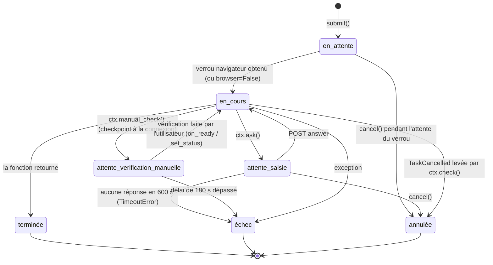
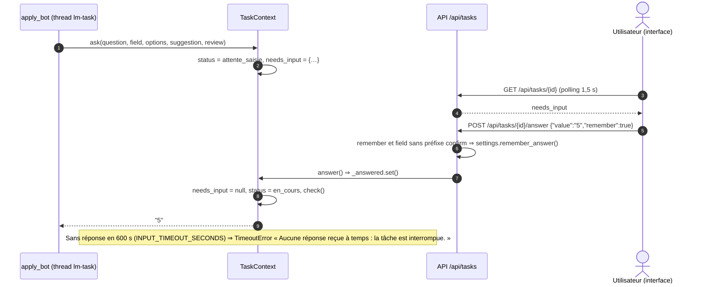

# Files d'Attente & Intégrations Tierces

> Pas de broker (Redis, Celery, RabbitMQ) : une instance sert un seul utilisateur et un seul navigateur à la fois
> (justification : lot 1 `01` § 1). Les tâches longues tournent dans le `TaskManager` en mémoire
> (`web/tasks.py`). Ce document décrit son comportement exact, puis chaque intégration externe : timeouts,
> relances, comportement sur blocage.

## 1. Gestion des Tâches d'Arrière-Plan (Queues & Workers)

### 1.1 Technologie
| Élément | `[ACTUEL]` | `[CIBLE]` |
| :--- | :--- | :--- |
| Exécuteur | `ThreadPoolExecutor(max_workers=4, thread_name_prefix="lm-task")` | inchangé |
| Sérialisation navigateur | `threading.Lock` partagé (`_browser_lock`) : une tâche `browser=True` attend le verrou par tranches de 0,5 s en restant `en_attente`, annulable pendant l'attente | inchangé |
| État | dictionnaire `_tasks` en mémoire, protégé par `RLock`, **et** table `tasks` : insertion à la soumission, mise à jour à chaque changement de statut / question (vague 1) | inchangé |
| Persistance | table `tasks` (vague 1) ; 100 dernières rechargées au démarrage ; tâches non finales ⇒ `échec` « Tâche interrompue par l'arrêt de l'application. » (`db/bootstrap.py`) | inchangé |
| Suivi client | polling `GET /api/tasks/{id}` toutes les 1,5 s | inchangé (pas de WebSocket/SSE : inutile en local) |
| Journal | `_TaskLogHandler` (logs du thread de la tâche) + `ctx.log()`, 400 lignes max | idem + `task_id` dans la console (cf. `02` § 3) |

### 1.2 Cycle de vie d'une tâche

Règles d'implémentation (`TaskManager._run`) :
- `started_at` est posé quand la tâche passe `en_cours` ; `finished_at` et `needs_input = None` dans le `finally`.
- Toute exception autre que `TaskCancelled` ou `pipeline.Cancelled` ⇒ `échec`, `error =
  logmask.mask_text(str(exc)) or exc.__class__.__name__` (masquage E-12, `01` § 1.2 G-9), 3 lignes de traceback
  ajoutées aux logs (elles aussi passées par `logmask.mask_text`). Une exception métier doit donc porter un
  **message français lisible**.
- `except TaskCancelled, CollectCancelled:` (syntaxe Python 3.14, PEP 758, sans parenthèses) ⇒ `annulée`, `error =
  "Tâche annulée."` ; couvre l'annulation coopérative (§ 1.5) **et** l'annulation pendant une collecte (E-22,
  `pipeline.Cancelled`, résolu en vague 2 : auparavant cette dernière finissait en `échec`).
- Le verrou navigateur est libéré dans le `finally` ; chaque fonction de tâche navigateur ferme son driver
  (`driver.quit()` en `finally`).
- `[ACTUEL]` (vague 2) `TaskManager.submit(..., on_abort=...)` : si la fonction de la tâche n'a **jamais démarré**
  (`started = False`, ex. annulation pendant l'attente du verrou navigateur, ou arrêt du processus), `on_abort()`
  est appelé dans le `finally`, après la libération du verrou. Sert à rendre une ressource réservée par la route
  avant la soumission (ex. plafond de messages, § 2.4) : la route `POST …/messages`
  (`web/routers/applications.py::send_message`) passe `on_abort=lambda: services.abort_message(message_id)`, qui
  marque la réservation `échec` plutôt que de la
  laisser `confirmé` sans suite. Une exception dans `on_abort` est journalisée (`log.warning`) et n'empêche pas la
  tâche de se terminer normalement.
- `[ACTUEL]` (vague 2) `TaskManager.answer()` consomme la question de façon **atomique** sous `self._lock` :
  `task.needs_input` est mis à `None` et `task.status` repasse à `en_cours` **avant** le retour de `answer()`, pas
  seulement à la reprise du thread de la tâche. Sans cela, un client qui relit la tâche juste après avoir répondu
  pouvait encore voir l'ancienne question et y répondre une seconde fois ; cette réponse en trop aurait alors été
  prise pour celle de la question suivante. `answer()` renvoie `False` si `ctx._answered` est déjà posé (réponse
  déjà reçue) en plus des cas existants (tâche/question absente).

### 1.3 Types de tâches

| `kind` | `browser` | `meta.key` (unicité) | Fonction (`web/services.py`) | Titre | `result` en `terminée` |
| :--- | :---: | :--- | :--- | :--- | :--- |
| `run` | `= scrape` | — (une seule) | `run_analysis` | `Collecte et analyse — <mot-clé>` / `Analyse de l'historique — <mot-clé>` | `{"report", "jobs", "counts", "blocked", "blocked_where"?}` (G-10, E-4 ; `blocked_where` absent si `blocked = false`) |
| `rescore` | non | — | `rescore` | `Recalcul des scores` | `{"report", "jobs"}` |
| `train` | non | — | `train_model` | `Entraînement du modèle de matching` | `{"report", "jobs", "n_labels", "accuracy"}` |
| `prepare` | non | `job_id` | `prepare_application` | `Préparer : <titre>` | `{"job_id", "folder", "generator"}` |
| `apply` | oui | `job_id` | `apply_job` | `Postuler : <titre ≤ 80>` | `{"state", "detail"}` |
| `contacts` | oui | `job_id` | `lookup_contacts` | `Chercher les recruteurs de l'offre` | `{"found", "emails"}` |
| `message` | si `linkedin` | `job_id` | `send_message` | `Envoyer un email` / `Envoyer un message LinkedIn` | `{"channel", "to", …}` |
| `import_profile` | oui | — | `import_linkedin_profile` | `Importer le profil LinkedIn` | `{"skills"}` |
| `profile_skill` | oui | compétence normalisée | `sync_skill_to_linkedin` | `Ajouter « <compétence> » au profil LinkedIn` | `{"skill", "linkedin_name", "state"}` |
| `purge` `[CIBLE]` | non | — | `RetentionService.purge` | `Purge de rétention` | `{"deleted": {"collected_items": 12, …}}` |

### 1.4 Saisie utilisateur et vérification manuelle

- `ask()` est la **seule** façon d'obtenir une valeur non mémorisée (I-05) et la **seule** façon de confirmer une
  action irréversible (`field="confirm_submit"`, options `["Soumettre", "Annuler"]`, `review` = texte de l'écran
  de relecture, 3 500 caractères max) (I-04).
- `manual_check(message)` : journalise le message (« LinkedIn demande une vérification (captcha, code 2FA...).
  Termine-la dans le navigateur : j'attends jusqu'à 180 s. ») et passe `attente_verification_manuelle`.
  L'utilisateur agit **lui-même** dans la fenêtre visible ; rien n'est automatisé (I-06, § 3.3 de `04`).

### 1.5 Annulation
- `POST /api/tasks/{id}/cancel` positionne un `Event` et débloque une attente de saisie ; l'annulation est
  **coopérative** : prise en compte à l'attente du verrou, dans `ask()`, et à chaque `ctx.check()` (entre deux
  champs ou deux étapes d'Easy Apply, dans les attentes de `outreach`, `contacts`, `profile_sync`).
- `[ACTUEL]` (vague 2, G-8/E-22) Pendant `pipeline.scrape`, l'annulation est testée **avant chaque page**
  (`LinkedInScraper._get`, via la fonction `check` passée au constructeur), pas seulement entre deux types
  d'éléments (offres, posts, profils) ; elle lève toujours `pipeline.Cancelled` (`RuntimeError`), désormais
  interceptée par `TaskManager._run` au même titre que `TaskCancelled` (§ 1.2) : la tâche finit en **`annulée`**
  avec « Tâche annulée. » (auparavant `échec` avec « Collecte annulée. »). Les éléments déjà lus par la méthode
  de collecte en cours (`scraper.partial`) sont enregistrés avant que l'exception ne remonte, en plus de ceux des
  types déjà terminés.
- Une page Selenium en cours de chargement n'est pas interrompue (jusqu'à 60 s).

### 1.6 Relances et échecs définitifs
- **Aucune relance automatique** de tâche : la plupart ont des effets externes non idempotents (candidature,
  message, ajout de compétence) ou sont limitées par la prudence ; relancer automatiquement augmenterait le risque
  de blocage (R-1). L'utilisateur relance depuis l'interface.
- Pas de *dead-letter queue* : une tâche en `échec` conserve `error` et ses logs ; `/api/monitor` liste les 5
  dernières erreurs. Table `tasks` `[ACTUEL]` ; conservation 12 mois par la tâche `purge` `[CIBLE]` (vague 6).
- Relances **internes** limitées aux appels idempotents en lecture : API France Travail (§ 2.5), SDK Anthropic
  (relances du SDK).

## 2. Intégrations Tierces & Webhooks

### 2.0 Webhooks entrants
**Aucun.** L'API n'est pas joignable depuis Internet (127.0.0.1) ; aucune source ne pousse d'événement. Les
réponses des recruteurs arrivent dans la boîte mail ou la messagerie LinkedIn de l'utilisateur, hors outil.

### 2.1 Navigateur piloté (Selenium) — `browser.py`
| Paramètre | Valeur |
| :--- | :--- |
| Version | `selenium>=4.50,<5` dans `linkedin_market/requirements.txt` `[ACTUEL]` (4.50.0 installé, suite verte) |
| Drivers | Selenium Manager ; `chromedriver` / `geckodriver` du `PATH` prioritaires (Firefox snap) |
| Choix | `LINKEDIN_BROWSER` : `auto` (Chrome puis Firefox), `chrome`, `firefox` ; `LINKEDIN_BROWSER_BINARY` |
| Fenêtre | visible par défaut (`LINKEDIN_HEADLESS=0`, recommandé : permet la vérification manuelle) ; 1366×900 (Chrome) |
| Chargement de page | `set_page_load_timeout(60)` |
| Échec de démarrage | `RuntimeError("Aucun navigateur utilisable (LINKEDIN_BROWSER=…) : …")` ⇒ tâche `échec` |
| Rythme | `human_pause(caution, facteur)` entre les pages |
| Options interdites | aucune option masquant l'automatisation (R-7) ; `tests/test_browser.py` le vérifie `[ACTUEL]` |

Repérage des éléments par texte et `aria-label` (FR + EN), jamais par classes CSS générées (R-5) ; tests hors ligne
sur `tests/fixtures/*.html`.

### 2.2 LinkedIn (source `linkedin`, mode `navigateur`)
**Session** (`session.py`) : cookies réutilisés si `logged_in_at` < 72 h (`SESSION_TTL_HOURS`), sinon fichier
supprimé et connexion par identifiants (`/login`, attente du champ email 30 s, du mot de passe 10 s, de `/feed`
20 s, puis vérification manuelle jusqu'à 180 s). La réutilisation ne prolonge pas la session.

**Timeouts par module** :
| Module | Attentes |
| :--- | :--- |
| `apply_bot` | `STEP_TIMEOUT` 10 s par étape, `SUBMIT_TIMEOUT` 20 s pour la confirmation d'envoi, `MAX_STEPS` 12 |
| `outreach.send_linkedin_message` | 12 s par élément attendu (fenêtre, champ de note) ; note de connexion ≤ 300 caractères (`LINKEDIN_NOTE_MAX`) |
| `contacts.find_hiring_team` | une page d'offre + une fenêtre « Coordonnées » par contact (3 max) |
| `scraper` | pages de recherche jusqu'à `max_items` par type ; recherche d'offres `f_TPR=r2592000` (30 jours), `f_WT=2` si `remote_only` |

**Détection et comportement sur blocage** (URL contenant `/checkpoint`, `/authwall`, `/login`, `/uas/`) :

| Module | Détection | Effet `[ACTUEL]` | Cible |
| :--- | :--- | :--- | :--- |
| `session.login` | URL ≠ `/feed` après `FEED_TIMEOUT` = 20 s, puis vérification manuelle (`MANUAL_CHECK_TIMEOUT` = 180 s) ; reprise par cookies (`_restore`) : `/checkpoint` après la pause de restauration (`RESTORE_PAUSE` = 4 s) | `[ACTUEL]` (vague 2, G-7/E-5) `attente_verification_manuelle` puis, si les 180 s sont dépassées (ou checkpoint après restauration par cookies), événement `blocked(where="connexion")` **puis** `VerificationNotDoneError` (`session._blocked_at_login()`) ⇒ tâche `échec` avec le message de G-7 (`01` § 1.2) | livré |
| `scraper` (collecte) | `_blocked()` **avant chaque page** (`LinkedInScraper._get`, § 1.5) | `[ACTUEL]` (vague 2, G-10/E-4, option A) arrêt immédiat de la navigation, `blocked(where="collecte")`, **analyse poursuivie** sur les données déjà obtenues, `result.blocked = true` (`01` § 1.2 G-10) | livré |
| `apply_bot` | avant d'ouvrir l'offre et à chaque étape | `BlockedError` ⇒ `blocked(where="candidature", job)`, `apply_state="échec"`, tâche `échec`, fenêtre de candidature fermée sans envoi | inchangé |
| `contacts` | après chaque page | `PermissionError` ⇒ `blocked(where="recherche de contacts")` ⇒ tâche `échec` | `BlockedError` unique |
| `outreach` (LinkedIn) | après ouverture du profil | `PermissionError` ⇒ `blocked(where="message LinkedIn")` ; après le clic sur « Envoyer » sans confirmation visible (page qui ne se vide pas, exception pendant l'attente) : `outreach.UncertainDelivery` plutôt que `PermissionError`, cf. § 2.4 | idem |
| `profile_sync` | après chaque ouverture | `PermissionError` ⇒ `blocked(where="profil LinkedIn (compétence)")` | idem |

Après un blocage : **repos de 6 h** pour **toutes** les actions navigateur (`guard_not_blocked`, HTTP 409 avec
l'heure de fin), levée uniquement par l'utilisateur (`POST /api/block/clear`) après vérification de son compte dans
un navigateur normal. Aucune nouvelle tentative automatique. `[CIBLE]` : le repos s'applique par source
(`activity_events.data.source_code`), un blocage LinkedIn ne bloquant pas Malt.

### 2.3 Claude (API Anthropic) — `interpreter.py`, `application.py`
| Paramètre | Valeur `[ACTUEL]` |
| :--- | :--- |
| SDK | `anthropic` (`linkedin_market/requirements.txt` : `>=1.9,<2` ; stable actuelle 1.12.1 du 2026-10-08), importé à la demande (dépendance optionnelle) |
| Client | `anthropic.Anthropic()` — clé lue dans `ANTHROPIC_API_KEY` ; délai et relances par défaut du SDK (2 relances avec backoff sur erreurs de connexion, 408, 409, 429, 5xx) |
| Modèle | `ANTHROPIC_MODEL` sinon `claude-opus-5-5` |
| Appel | `client.beta.messages.stream(model, max_tokens=16000, system, thinking={"type": "adaptive"}, output_config={"effort": "high"}, betas=["server-side-fallback-2026-07-01"], fallbacks="default", messages=[…])` puis `get_final_message()` |
| Fin anormale | `stop_reason == "refusal"` ⇒ `RuntimeError("Claude a refusé la requête.")` ; `max_tokens` ⇒ texte suffixé « _(Réponse tronquée : limite de longueur atteinte.)_ » |

`[ACTUEL]` (vague 2, G-4/E-7) : la branche `interpreter="none"` de `interpreter.get_interpreter()` / `interpret()`
a été retirée — ces fonctions ne renvoient plus jamais `None` / `("", "none")`. Toute valeur autre que `claude`
(dont l'ancienne valeur `none`) donne l'interprète **local**, qui produit toujours un texte (I-11).

Usages et données transmises :
| Usage | Données envoyées | Repli |
| :--- | :--- | :--- |
| Interprétation du rapport (`interpret`) | `summary_for_interpreter()` : mot-clé, profil résumé, compteurs, 25 termes, 25 compétences, tendances, écart, 10 meilleures offres (titre, entreprise, lieu, score, compétences manquantes, critères), poids du modèle — **agrégats uniquement** | Claude non instanciable (clé ou SDK absent) ou en erreur ⇒ `LocalInterpreter`, `interpreter="local"` dans le rapport (I-11) |
| Rédaction du CV, du message et des conseils (`_generate_with_claude`) | texte complet du profil de l'utilisateur, profil résumé, offre (champs scorés + texte intégral **après `nlp.redact_third_parties`** `[CIBLE]` vague 6), contexte marché | erreur ou CV vide ⇒ `_generate_locally` (assemblage sans reformulation), `generator="local"` |

E-6 tranchée (2026-10-09, option A) : le texte de l'offre sort de la machine pour la rédaction du CV **seulement après** retrait des noms, emails, téléphones et URL de profils de personnes (`nlp.redact_third_parties`, `[CIBLE]` vague 6, cf. `02` § 4).
`[CIBLE]` : `timeout=120` s explicite sur le client ; aucune donnée `person` ni contact n'est jamais transmise ;
mention dans la popup Claude/Réglages de ce qui est envoyé.

### 2.4 SMTP (serveur de l'utilisateur) — `outreach.py`
| Paramètre | Valeur |
| :--- | :--- |
| Configuration | `SMTP_HOST`, `SMTP_FROM` (sinon `SMTP_USER`) obligatoires ; `SMTP_SECURITY` `starttls` (défaut, port 587) ou `ssl` (465) ; `SMTP_USER`/`SMTP_PASSWORD` si le serveur exige l'authentification |
| `[ACTUEL]` (vague 2, G-5/E-20) | `SMTP_SECURITY=none` (sans chiffrement) admis **uniquement** vers un hôte local (`127.0.0.1`, `localhost`, `::1` — relais local, tests), via `config.smtp_security_error()` ; sinon `OutreachError` (503 à l'API). **Toute autre valeur** (ni `ssl`, `starttls`, ni `none`) est **refusée même vers un hôte local** : « SMTP_SECURITY=<valeur> n'est pas reconnu : choisis starttls ou ssl dans le fichier .env (none seulement pour un serveur SMTP local, 127.0.0.1). » — remplace l'ancien comportement qui retombait silencieusement sur le port 25 sans chiffrement. Contrôlé à l'API (`applications._require_smtp()`) **et** au début de la tâche (`services.send_message`, avant `outreach.deliver_email`). |
| Délai | `SMTP_TIMEOUT = 25` s, contexte TLS `ssl.create_default_context()` (vérification du certificat) |
| Message | `EmailMessage` : `From`, `To` validé, `Subject` sur une ligne, `Message-ID` (`make_msgid` au domaine de l'expéditeur), corps texte (+ pied imposé), pièce jointe `cv.pdf` facultative ; `[ACTUEL]` (vague 4) `List-Unsubscribe: <mailto:{adresse nue de SMTP_FROM}?subject=STOP>` sur les messages de `/messages` seulement (pas `/smtp/test`, pas de `List-Unsubscribe-Post`) |
| Erreurs | `SMTPAuthenticationError` ⇒ « Le serveur SMTP refuse l'authentification : vérifie SMTP_USER et SMTP_PASSWORD. » ; `SMTPRecipientsRefused` ⇒ « Le destinataire a été refusé par le serveur : <to masqué, E-12>. » ; autre ⇒ « Envoi impossible (<Classe> : <détail>). » (`outreach._smtp_failure`) |
| `[ACTUEL]` (vague 2) | Une erreur à la **fermeture** de la connexion (`client.quit()`) **après** que le serveur a accepté le message (`client.send_message(message)` réussi) est **ignorée** (`outreach.deliver_email`, `except smtplib.SMTPException, OSError: client.close()`) : le message est considéré envoyé (`Message-ID` retourné et stocké dans `outreach_messages.smtp_message_id`), une erreur de `QUIT` ne change rien à la livraison déjà actée par le serveur. |
| Relance | **aucune** (risque de doublon chez le destinataire) ; statut `échec`, nouvel envoi manuel |

**Statut « à vérifier » (`outreach.UncertainDelivery`, canal LinkedIn uniquement)** `[ACTUEL]` (vague 2) :
après le clic sur le bouton « Envoyer » d'un message direct LinkedIn, si l'attente de confirmation (le composeur
qui se vide) échoue avec une exception (annulation, perte de page…) plutôt qu'un simple délai dépassé,
`send_linkedin_message` lève `outreach.UncertainDelivery` (sous-classe de `OutreachError`) au lieu de
`OutreachError` : le message a **peut-être** été envoyé sans confirmation visible. `services.send_message` la
distingue des autres échecs : la réservation (`outreach_messages`) reste `status='confirmé'` avec `error`
renseigné au lieu de passer à `échec` (`db/repositories/outreach.note_uncertain`, `03` § 5.1) — affiché « à
vérifier » côté UI, compte toujours dans le plafond du jour, **jamais** renvoyé automatiquement (§ 1.6, I-04).
Un délai simplement dépassé (composeur non vidé, sans exception) reste une `UncertainDelivery` classique avec le
même message : « L'envoi n'a pas pu être confirmé : vérifie la conversation sur LinkedIn avant de réessayer. »

Conformité prospection B2B `[ACTUEL]` (vague 4, 2026-10-12 ; `outreach.compose_footer`, `assemble`, `connection_note`, `List-Unsubscribe` ; I-12, I-13 ; CPCE art. L.34-5 ; RGPD art. 6(1)(f), 14 et 21 ; fiche CNIL
« Communication électronique : quelles règles ? », mise à jour en juin 2026) :
- **Objet** du message en rapport avec la fonction du destinataire : une offre qu'il publie (rattachement à une
  `applications` obligatoire, pas d'envoi libre).
- **Pied imposé** `[ACTUEL]`, ajouté par le backend et non supprimable dans l'interface (textes exacts : `01` § 5.7.1 ; `strip_footer` n'évite que le doublon d'un pied exact, le pied est toujours rajouté) :
  « Je vous contacte au sujet de votre offre « <titre> » ; votre adresse provient de <source : votre profil
  LinkedIn / l'offre publiée / saisie manuelle>. Pour ne plus recevoir de message de ma part, répondez « STOP » ou
  écrivez à <expéditeur> : votre demande sera prise en compte immédiatement. »
- **En-tête** `List-Unsubscribe: <mailto:<expéditeur>?subject=STOP>`. Pas de `List-Unsubscribe-Post` (RFC 8058) :
  il exigerait une URL HTTPS publique, incompatible avec une instance locale. La CNIL attend un moyen de
  désinscription « simple, gratuit et immédiat » ; la réponse par email est le seul canal disponible sans
  serveur public. **Décidé le 2026-10-09 (P-5, option A)** : réponse « STOP » + en-tête `List-Unsubscribe` mailto
  sur chaque email ; l'utilisateur enregistre lui-même l'opposition (`POST /api/suppressions`) ; pas de lecture
  IMAP, pas de lien HTTPS.
- **Opposition** : tout « STOP » reçu est saisi par l'utilisateur (`POST /api/suppressions`) ; le contrôle
  `suppression_list` dans la transaction d'envoi rend tout nouvel envoi impossible (409).
- **Volume** : `message_daily_max` (15), pas de séquence de relances automatiques, un message par action
  confirmée (I-04).

### 2.5 API France Travail « Offres d'emploi v2 » (source `france_travail`, mode `api_officielle`) `[CIBLE]`
Module `linkedin_market/sources/france_travail.py` (client `httpx` synchrone, appelé dans la tâche `run`).

| Élément | Valeur |
| :--- | :--- |
| Prérequis | Application déclarée sur francetravail.io, abonnée à l'API « Offres d'emploi v2 » ; `FRANCE_TRAVAIL_CLIENT_ID` / `FRANCE_TRAVAIL_CLIENT_SECRET` dans `.env`. Sans identifiants : source ignorée, `GET /api/sources` indique `configured: false`. |
| Authentification | `POST https://entreprise.francetravail.fr/connexion/oauth2/access_token?realm=%2Fpartenaire`, `Content-Type: application/x-www-form-urlencoded`, corps `grant_type=client_credentials&client_id=…&client_secret=…&scope=api_offresdemploiv2 o2dsoffre`. Réponse `{"access_token", "token_type": "Bearer", "expires_in", "scope"}`. Jeton gardé **en mémoire** et renouvelé 60 s avant `expires_in` ; `401` sur un appel ⇒ un renouvellement puis une seule nouvelle tentative. |
| Recherche | `GET https://api.francetravail.io/partenaire/offresdemploi/v2/offres/search` avec `Authorization: Bearer <jeton>`, `Accept: application/json`. Paramètres utilisés : `motsCles` (mot-clé), `publieeDepuis=31` (fenêtre des tendances), `range=0-<max_items−1>`, `sort=1` ; `departement` / `commune` si `location` correspond à un lieu français. |
| Pagination | `range=p-d` : 150 offres maximum par appel ; premier indice ≤ 1000, dernier ≤ 1149. Le plafond de la prudence (≤ 60) tient en **un seul appel**. En-tête `Content-Range: offres 0-59/1234` (total disponible, affiché dans les logs). |
| Codes | `200` toutes les offres du périmètre renvoyées ; `206 Partial Content` résultats partiels (d'autres pages existent) — traité comme un succès ; `204` aucune offre ; `400` paramètre ou `range` invalide (erreur de programmation, pas de relance) ; `401` jeton expiré ; `429` / `5xx` relance. |
| Débit | limite documentée 10 appels/s ; le client s'impose ≤ 2 appels/s (une recherche par analyse en pratique). |
| Délais et relances | timeout 10 s ; 3 tentatives avec backoff exponentiel 1 s, 2 s, 4 s sur `429`, `500`, `502`, `503`, `504` et erreurs réseau ; `Retry-After` respecté s'il est présent. Échec définitif ⇒ `SourceUnavailable` journalisée, **l'analyse continue** avec les autres sources. |
| Correspondance | `id` → `external_id` ; `intitule` → `title` ; `description` → `text` ; `entreprise.nom` → `company` ; `lieuTravail.libelle` → `location` ; `dateCreation` → `posted_at` ; `origineOffre.urlOrigine` → `url` ; `competences[].libelle` complètent les compétences extraites par `nlp` ; `kind="job"`, `source_code="france_travail"`. |
| Risques | Aucun risque de compte (API officielle) : pas de popup, pas de blocage, pas de repos. Respect des conditions d'utilisation de l'API (réutilisation des offres pour l'usage personnel de l'utilisateur). |

### 2.6 Malt et Welcome to the Jungle (sources `malt`, `wttj`, mode `navigateur`) `[CIBLE]`
- Pas d'API publique de lecture des offres (R-6) : collecte par le navigateur de l'utilisateur, avec **les mêmes
  règles que LinkedIn** : consentement versionné (I-16, HTTP 428), compte propre (I-08), plafonds de prudence
  (I-07), arrêt et repos de 6 h au premier blocage (I-06), aucune action d'écriture (pas de candidature ni de
  message automatisés sur ces plateformes).
- Interface commune `Source` (`code`, `access_mode`, `collect(request, ctx) -> list[Item]`) ; un module par
  plateforme, sélecteurs par texte/`aria-label`, fixtures HTML hors ligne.
- Détection de blocage propre à chaque plateforme (page de connexion, défi anti-robot, code HTTP 403/429 affiché) ⇒
  `BlockedError(where="collecte malt")`. Aucune tentative de contourner un défi.

### 2.7 Indeed (source `indeed`, mode `import_manuel`) `[CIBLE]`
- L'API *Job Sync* d'Indeed est réservée aux partenaires approuvés et son contrat développeur interdit le
  scraping (R-6) : **aucun appel réseau vers Indeed**, ni API ni navigateur, ni même téléchargement de l'URL
  fournie.
- L'utilisateur colle l'offre (URL pour mémoire, titre, entreprise, lieu, texte) : `POST /api/items/import` ⇒
  `collected_items(kind="job", source_code="indeed", external_id = sha256(url normalisée)[:16])` ; `409` si déjà
  présente. L'offre est ensuite scorable et éligible à une préparation de candidature comme les autres (pas
  d'Easy Apply : `apply` refusé pour une source autre que `linkedin`, 422).

## 3. Récapitulatif des Délais et Relances

| Appel | Délai | Relances | Sur échec définitif |
| :--- | :--- | :--- | :--- |
| Saisie utilisateur (`ask`) | 600 s | — | tâche `échec` |
| Vérification manuelle à la connexion LinkedIn | 180 s | — | tâche `échec` + `blocked(where="connexion")` (G-7/E-5, `[ACTUEL]`) |
| Chargement de page Selenium | 60 s | 0 | page ignorée (collecte) ou tâche `échec` |
| Étape Easy Apply / confirmation d'envoi | 10 s / 20 s | l'étape est repassée tant que les erreurs affichées changent (12 étapes max) | `ApplyError` / état `incertaine` |
| Message LinkedIn (éléments attendus) | 12 s | 0 | `OutreachError`, ou `UncertainDelivery` après le clic « Envoyer » (§ 2.4) |
| SMTP | 25 s | 0 | `OutreachError` ⇒ `échec` |
| Claude | défaut SDK (`timeout=120` s `[CIBLE]`) | 2 (SDK) | interprète / rédacteur local |
| France Travail (jeton, recherche) `[CIBLE]` | 10 s | 3, backoff 1-2-4 s, `Retry-After` | source ignorée pour cette analyse |
| Blocage navigateur | — | **jamais** | repos de 6 h, levée manuelle |

## 4. Sources

- CNIL, « Communication électronique : quelles règles ? » : https://www.cnil.fr/fr/communication-electronique-quelles-regles
- Code des postes et des communications électroniques, art. L.34-5 (Légifrance).
- France Travail, catalogue d'API (francetravail.io) et fiche « API Offres d'emploi » sur data.gouv.fr :
  https://www.data.gouv.fr/dataservices/api-offres-demploi
- Documentation communautaire de l'API (pagination, `Content-Range`, limites) : https://jobspipe.dev/blog/france-travail-api
- Versions PyPI consultées le 2026-10-08 : fastapi 0.142.4, pydantic 2.13.5, sqlalchemy 2.1.4, alembic 1.20.0,
  psycopg 3.3.6, selenium 4.50.0, anthropic 1.12.1, uvicorn 0.54.0, cryptography 50.0.2.
