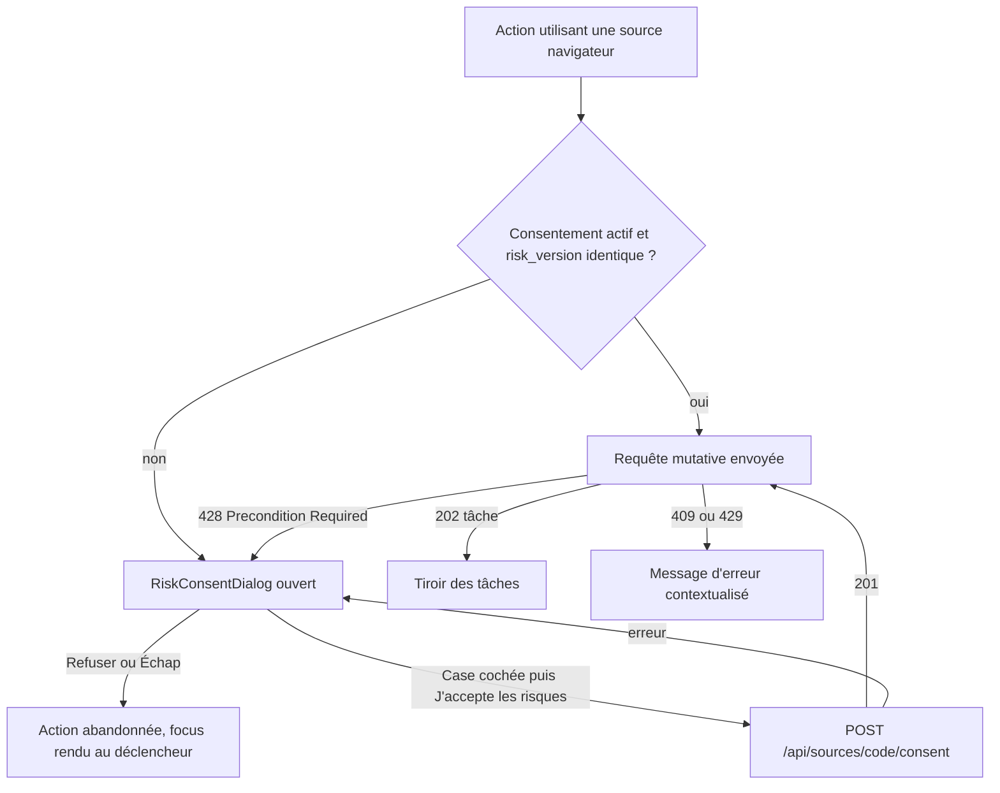
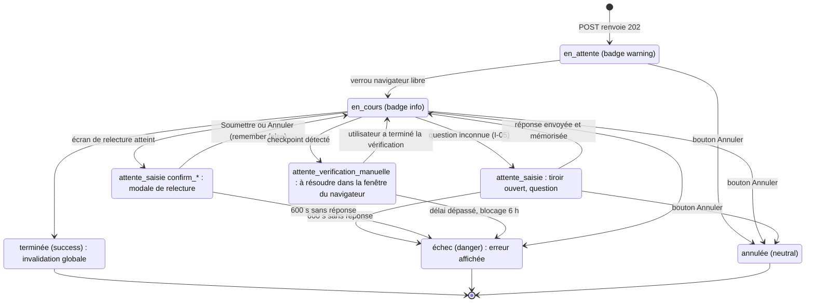

# Catalogue de Composants UI

> Vérifié dans `web/frontend/src/` : `ui.tsx` (primitives), `components/` (`TaskDrawer.tsx`, `RunModal.tsx`,
> `ComposeModal.tsx`, `icons.tsx`), composants locaux aux pages (`pages/*.tsx`). Aucune bibliothèque de
> composants externe (ni Radix, ni Headless UI) : uniquement React 18 + Tailwind ; Markdown rendu par
> `react-markdown` 10 + `remark-gfm` 4 (sans HTML brut : `rehype-raw` n'est pas utilisé, donc pas d'injection HTML).

## 1. Organisation des Composants

### 1.1 Arborescence réelle `[ACTUEL]`

```
src/
├── main.tsx               QueryClient, BrowserRouter, TaskProvider, thème initial
├── App.tsx                coquille : navigation latérale, bandeaux globaux, <Routes>
├── api.ts                 client HTTP + types partagés (Task, Settings, Job, Report…)
├── hooks.ts               hooks TanStack Query (useStatus, useJobs…) + useAction
├── ui.tsx                 primitives : Badge, Card, Button, Field, inputClass, ErrorBox, Notice, Empty,
│                          PageHeader, Modal, Tabs, scoreTone, statusTone, formatDate
├── index.css              jetons CSS, .prose-md, animations
├── components/
│   ├── TaskDrawer.tsx     TaskProvider (contexte useTaskUi), tiroir des tâches, modale de relecture confirm_*
│   ├── RunModal.tsx       formulaire « Lancer une analyse »
│   ├── ComposeModal.tsx   rédaction + relecture d'un message à l'entreprise
│   └── icons.tsx          Icon (SVG au trait 24×24, 22 noms)
└── pages/
    ├── Dashboard.tsx      QuotaBar, ActivityChart (locaux)
    ├── Jobs.tsx           JobDetailModal (exporté, réutilisé par Market)
    ├── Market.tsx         Panel, SectionHeading, ScoreRing, Bars, WeeklyChart, Kpi, OfferCard, CopyButton, MarketBody
    ├── Applications.tsx   Dossier, Apply, Contacts, History, Detail (locaux)
    ├── Skills.tsx
    └── SettingsPage.tsx
```

### 1.2 Organisation cible `[CIBLE]`

La structure plate reste adaptée à la taille du projet (≈ 2 000 lignes). Règles d'évolution :
- une primitive réutilisée par **deux pages ou plus** va dans `ui.tsx` (ex. `Panel`, `ScoreRing`, `Bars` si
  réutilisés hors de Marché) ; au-delà de ~300 lignes, éclater `ui.tsx` en `ui/` (un fichier par primitive,
  réexport par `ui/index.ts`) ;
- un composant métier transverse va dans `components/` : nouveaux `RiskConsentDialog.tsx`,
  `SourcePicker.tsx`, `OppositionDialog.tsx`, `ManualImportModal.tsx`, `InterpreterBadge.tsx`,
  `ErrorBoundary.tsx`, `ConfirmDialog.tsx` ;
- les textes de risques versionnés vont dans `src/content/risks.ts` (cf. § 4.1) ;
- les schémas de formulaire Zod dans `src/schemas.ts` (cf. `05-forms-and-validation.md`).

## 2. États Obligatoires par Composant

| État | Implémentation actuelle `[ACTUEL]` | Règle `[CIBLE]` |
| :--- | :--- | :--- |
| Default | Classes de `Button` / `inputClass`. | Inchangé. |
| Hover | `hover:bg-bg-secondary`, `hover:bg-accent-hover`, `hover:opacity-90` (danger), `transition` sur `Button`. | Inchangé. |
| Focus | Contour natif sur les boutons ; champs : `focus:border-accent-primary` seulement. | Anneau `focus-visible:ring-2` partout (cf. `01-ui-design-system.md` § 4.2). |
| Active / Pressed | Non stylé ; boutons bascule (annotation) via `variant` ou `aria-pressed` (Marché). | `aria-pressed` sur tout bouton bascule. |
| Disabled | `disabled:cursor-not-allowed disabled:opacity-50` ; `disabled` aussi pendant `loading`. | Expliquer la raison (texte ou `title` + `aria-describedby`) quand le blocage vient d'une règle métier (plafond, blocage, identifiants). |
| Loading / Busy | `Button loading` remplace le libellé par « … » ; pages : « Chargement… » ; Marché : squelette `h-40 animate-pulse`. | `aria-busy="true"` + libellé conservé avec indicateur (« Lancer… ») pour ne pas perdre le nom accessible ; largeur minimale pour éviter le décalage. |
| Error | `ErrorBox` (`role="alert"`, bordure `danger/40`). | Erreur de champ sous le champ, `aria-invalid` + `aria-describedby` (cf. `05`). |
| Empty | `Empty` (bordure pointillée, texte d'action : « Lance une analyse, ou assouplis les filtres. »). | Toujours proposer l'action suivante. |

## 3. Primitives (`ui.tsx`) `[ACTUEL]`

### 3.1 `Badge`
`{ tone?: Tone = "neutral"; children: ReactNode }` — `span` arrondi `rounded-full px-2 py-0.5 text-xs font-medium`.
Usage : scores, statuts de candidature et de tâche, compétences (« ✓ python », « ✗ aws »), types d'événement.

### 3.2 `Card`
`{ title?: ReactNode; actions?: ReactNode; children: ReactNode; className?: string }` — `<section>` avec
en-tête `<h2>` si `title` ou `actions`. Bordure, `bg-surface`, `rounded-lg`, `p-4`, **sans ombre**
(contrairement à `Panel` de Marché qui a `shadow-card` et `rounded-xl`).

### 3.3 `Button` — type `ButtonProps`
```ts
type ButtonProps = {
  children: ReactNode; onClick?: () => void;
  variant?: "primary" | "secondary" | "danger" | "ghost";   // défaut "secondary"
  disabled?: boolean; loading?: boolean;                     // loading ⇒ disabled + libellé « … »
  type?: "button" | "submit";                                // défaut "button"
  small?: boolean;                                           // px-2.5 py-1 text-xs, sinon px-3.5 py-2 text-sm
  title?: string;
};
```
Pas de `aria-label`, `aria-pressed` ni `ref` : `[CIBLE]` étendre avec `...rest: ButtonHTMLAttributes` pour
l'accessibilité (nécessaire au piège de focus et aux boutons bascule).

### 3.4 `Field` et `inputClass`
`Field { label: string; hint?: string; children: ReactNode }` — `<label>` englobant : libellé
(`font-medium text-text-secondary`), champ, aide (`text-xs text-text-muted`). `inputClass` : chaîne de classes
partagée par `input`, `select`, `textarea`. `[CIBLE]` prop `error?: string` (message sous le champ, `id`
généré par `useId()` relié par `aria-describedby`, `aria-invalid`).

### 3.5 `ErrorBox`, `Notice`, `Empty`, `PageHeader`
- `ErrorBox { error: unknown }` : rien si `error` est falsy ; sinon `error.message` (ou `String(error)`).
- `Notice { tone?: Tone = "info"; children }` : bandeau non annoncé (`[CIBLE]` `role="status"` pour succès / info).
- `Empty { children }` : état vide.
- `PageHeader { title: string; subtitle?: string; actions?: ReactNode }` : `<h1>` de page. Marché a son propre
  en-tête (animé), mais garde un `<h1>`.

### 3.6 `Modal`
`{ title: string; onClose: () => void; children: ReactNode; wide?: boolean }` — voile `fixed inset-0 z-50
bg-black/40`, boîte `max-w-lg` (`wide` : `max-w-3xl`), `max-h-[90vh]` défilante. Ferme sur **Échap** (écouteur
`window`) et sur **clic du voile** ; bouton « ✕ » `aria-label="Fermer"`.

Écarts et cible `[CIBLE]` :
- `aria-labelledby` vers le `<h2>` au lieu de `aria-label` ;
- **focus initial** sur le premier élément interactif (ou sur l'élément désigné par `initialFocus`) ;
- **piège de focus** (Tab / Maj+Tab bouclent dans la boîte) — implémentation recommandée : élément natif
  `<dialog>` + `showModal()` (piège, `inert` du reste de la page et Échap natifs, pris en charge par tous les
  navigateurs récents) ;
- **restitution du focus** à l'élément déclencheur à la fermeture ;
- prop `dismissible?: boolean` (défaut `true`) : `false` désactive la fermeture par clic du voile pour les
  dialogues de décision (popup de risques, relecture) — Échap reste actif mais vaut **refus** ;
- plusieurs modales empilées (`JobDetailModal` → `RunModal` impossible aujourd'hui, mais modale de relecture
  `confirm_*` qui peut s'ouvrir par-dessus n'importe quelle page) : seule la plus haute réagit à Échap.

### 3.7 `Tabs<T extends string>`
`{ tabs: { id: T; label: string }[]; value: T; onChange: (id: T) => void }` — `role="tablist"` / `role="tab"`
/ `aria-selected`. Utilisé par la candidature (Dossier, Postuler, Contacts (n), Historique) et `ComposeModal`
(Email (SMTP), Message LinkedIn). `[CIBLE]` flèches gauche / droite, `tabIndex` itinérant, `aria-controls`.

### 3.8 Fonctions utilitaires
`scoreTone`, `statusTone` (cf. `01-ui-design-system.md` § 1.2), `formatDate(value?)` →
`toLocaleString("fr-FR", { dateStyle: "short", timeStyle: "short" })`, valeur brute si date invalide.

### 3.9 `Icon` (`components/icons.tsx`)
`{ name: IconName; className?: string = "h-4 w-4" }` — SVG `stroke="currentColor"`, `aria-hidden`. Noms :
`chart, trend, target, scale, user, info, spark, play, external, download, copy, check, plus, thumbUp,
thumbDown, doc, users, clock, pin, refresh, arrowRight`. Choisi pour éviter les emojis — la page Offres utilise
encore 👍 / 👎 / ✓ / ✗ en texte : `[CIBLE]` remplacer par `Icon thumbUp` / `thumbDown`.

## 4. Composants Métier

### 4.1 `RiskConsentDialog` — popup de risques d'une source `[CIBLE]` (I-16, R-1, R-3, R-6)

**Props** :
```ts
interface RiskConsentDialogProps {
  source: SourceInfo;              // { code: "linkedin" | "malt" | "wttj"; label: string; access_mode: "navigateur";
                                   //   risk_version: string; consent: { risk_version: string; accepted_at: string } | null }
  onAccepted: () => void;          // reprend l'action interrompue
  onRefused: () => void;           // abandonne l'action, aucune requête mutative
}
```

**Quand l'afficher** — avant toute action qui utilise une source `navigateur` si
`consent === null || consent.risk_version !== source.risk_version`. Points d'entrée : `RunModal` (sources
cochées), « Lancer la candidature », « Chercher les recruteurs de l'offre », message LinkedIn,
« Importer depuis LinkedIn », ajout de compétence avec `linkedin_skill_sync`. Si l'API répond **428** malgré tout
(consentement révoqué ailleurs, version changée entre-temps), le client ouvre la popup pour la source indiquée
puis **rejoue** la requête initiale une seule fois après acceptation.

**Contenu** (texte versionné dans `src/content/risks.ts`, clé `"{code}@{risk_version}"` ; si la clé est absente,
la popup affiche « Texte de risques introuvable pour la version {v} : mets à jour l'application » et n'autorise
pas l'acceptation) — exemple pour `linkedin@2026-10` :

1. **Titre** : « Avant d'utiliser LinkedIn avec cet outil ».
2. **Ton compte peut être restreint ou suspendu.** Les conditions d'utilisation de LinkedIn (*User Agreement*,
   version du 3 novembre 2025, § 8.2 « À ne pas faire », points 2, 3 et 13) interdisent les logiciels de collecte
   automatisée, le contournement des limites d'usage et les bots pour accéder au service, envoyer des messages ou
   ajouter des contacts. Cet outil pilote un navigateur avec **ton** compte : LinkedIn peut le détecter et
   restreindre ou fermer ce compte. Ce risque est le tien.
3. **Tu traites des données personnelles de tiers (RGPD).** En installant l'outil, tu es responsable de
   traitement pour les profils, posts et recruteurs collectés. L'outil limite ce qu'il garde (titre et compétences
   seulement pour un profil, aucune donnée sensible — I-09), supprime posts et profils après 30 jours (I-10) et
   n'envoie jamais à Claude de donnée identifiable sur un tiers : l'interprétation ne reçoit que des agrégats ;
   la préparation d'un CV, si tu utilises Claude, lui transmet ton propre profil et le texte de l'offre (I-11, E-6). Tu dois répondre aux demandes des personnes concernées.
4. **Des plafonds de prudence s'appliquent et ne peuvent pas être dépassés.** `prudent` : 15 éléments par type,
   pause de 6 à 14 s ; `normal` : 30, 4 à 9 s ; `agressif` : 60, 2,5 à 6 s ; au plus {apply_daily_max}
   candidatures et {message_daily_max} messages par jour (I-07). Au premier signe de vérification (checkpoint,
   CAPTCHA), l'outil **s'arrête** et attend 6 h ; il ne tente jamais de contourner la vérification (I-06).
5. **Conseil** : commence en **`prudent`**, garde le navigateur visible, et préfère la source **France Travail**
   (API officielle, sans risque pour ton compte) quand elle suffit.
6. Ligne de version : « Version des risques : 2026-10 ». Si `consent` existe avec une autre version :
   bandeau « Ce texte a changé depuis ton acceptation du {date} : relis-le. »

Pour `malt` et `wttj`, mêmes sections 3 à 6 ; la section 2 cite « les conditions d'utilisation de Malt /
Welcome to the Jungle, qui ne proposent pas d'API publique de lecture des offres » sans numéro d'article (aucun
article n'est référencé dans le lot 1).

**Commandes** :
- case à cocher `J'ai lu ces risques et je les accepte pour mon compte {label}` (non cochée à l'ouverture) ;
- case facultative, cochée par défaut si la prudence courante n'est pas `prudent` : `Passer la prudence à
  « prudent »` (enregistre `caution: "prudent"` via `PUT /api/settings` après acceptation) ;
- bouton secondaire **« Refuser »** ; bouton primaire **« J'accepte les risques »**, `disabled` tant que la case
  n'est pas cochée, `loading` pendant `POST /api/sources/{code}/consent`
  `{"risk_version": "...", "accepted": true}` (201).

**Accessibilité** : `<dialog>` modal, `aria-labelledby` (titre), `aria-describedby` (texte des risques) ;
`dismissible = false` (clic sur le voile sans effet) ; **Échap = Refuser** ; focus initial sur le **titre**
(`tabIndex=-1`) pour que le lecteur d'écran lise le texte depuis le début, puis Tab → case → boutons ; piège de
focus ; restitution du focus au bouton déclencheur ; corps défilant si > 90 vh, boutons toujours visibles
(pied fixe, critère 2.4.11).

**Erreurs** : `ErrorBox` dans la popup, case conservée ; un 409 / 422 renvoyé par l'enregistrement est affiché
tel quel ; un échec réseau laisse la popup ouverte.

**Révocation** : carte « Sources et consentements » de la page Paramètres (cf. `04-routing-and-pages.md`) —
pour chaque source `navigateur` : mode d'accès, version acceptée, date, bouton « Révoquer » (dialogue de
confirmation, puis `DELETE /api/sources/{code}/consent`). Après révocation, la prochaine action réaffiche la popup.



### 4.2 Écrans de relecture avant envoi (I-04)

**a) Candidature simplifiée — modale « Relire avant l'envoi »** (`TaskProvider`) `[ACTUEL]`
- Ouverte automatiquement dès qu'une tâche de `useTasks()` est en `attente_saisie` avec `needs_input.field`
  commençant par `confirm` (aujourd'hui uniquement `confirm_submit`, options `["Soumettre", "Annuler"]`,
  `review` = texte de l'écran de relecture LinkedIn tronqué à 3 500 caractères).
- Affiche la question, une explication (« Rien n'est envoyé tant que tu ne cliques pas sur « Soumettre » »), le
  `review` dans un `<pre>`, un bouton par option (le premier en `primary`).
- Réponse via `POST /api/tasks/{id}/answer` avec **`remember: false`** ; le serveur refuse aussi de mémoriser un
  champ `confirm*` (double garde). Fermeture (Échap, voile, « ✕ ») = **dernière option** (« Annuler »).
- `[CIBLE]` : `dismissible = false` pour le voile (Échap reste « Annuler »), focus initial sur « Annuler »
  (choix sûr), afficher le titre de l'offre et l'entreprise, et le délai restant (600 s, `INPUT_TIMEOUT_SECONDS`).

**b) Message à l'entreprise — `ComposeModal`** `[ACTUEL]`
- Props : `{ app: ApplicationDetail; contact?: Contact; onClose: () => void }`.
- Étape 1 (rédaction) : onglets canal, destinataire, objet (email), « Joindre le CV (PDF) », message, compteur ;
  bouton « Relire avant l'envoi » désactivé si champ requis vide, plafond atteint ou SMTP absent (email).
- Étape 2 (relecture) : bandeau « Ce message sera réellement envoyé », liste `<dl>` (Canal, Destinataire, Objet,
  Pièce jointe, Message) ; « Modifier » revient à l'étape 1 sans perte ; « Confirmer l'envoi » →
  `POST /api/applications/{id}/messages` avec `confirm: true` → `track(task)` puis fermeture.
- `[CIBLE]` (I-12, I-13, R-4) :
  - ligne **Origine de l'adresse** : « Affichée par LinkedIn dans l'équipe de recrutement de l'offre, le
    {collected_at} » (`source = linkedin_equipe_recrutement` ; le code actuel de `contacts.py` écrit encore
    `"linkedin"`, et l'UI l'affiche aujourd'hui en badge « trouvé via linkedin ») ou « Saisie par toi » (`manuel`) ;
  - **mention de désinscription** ajoutée par le serveur au gabarit, affichée en lecture seule sous le message
    (non modifiable, non supprimable), texte exact = « pied imposé » défini dans `backend/05-queues-and-integrations.md` (source unique, renvoyé
    par `GET /api/applications/{job_id}/message-draft`) ;
  - case obligatoire **« J'ai relu ce message et je confirme l'envoi »** avant d'activer « Confirmer l'envoi » ;
  - si le destinataire est dans la liste d'opposition (réponse 409 du serveur, ou indicateur `opposed: true` du
    contact) : bandeau `danger` « Cette personne a demandé à ne plus être contactée : envoi impossible » et
    bouton désactivé — aucun moyen de forcer ;
  - focus initial sur le premier élément de la relecture ; « Confirmer l'envoi » n'a jamais le focus initial.

### 4.3 `TaskProvider` / tiroir des tâches (`TaskDrawer.tsx`) `[ACTUEL]`

- **Contexte** `useTaskUi(): { track(task: Task): void }` — ouvre le tiroir sur une tâche venant d'être créée et
  invalide `["tasks"]`. Utilisé après chaque mutation qui renvoie une tâche (202).
- **Bouton flottant** « Tâches · N en cours » (bas droite, `z-40`), orange quand une tâche attend l'utilisateur.
  `[CIBLE]` `aria-expanded`, `aria-controls`, contraste (cf. `01` § 4.1).
- **Tiroir** (`<aside aria-label="Tâches">`) : liste (titre, badge de statut, date, erreur tronquée) ou détail
  (`TaskDetail`).
- **Ouverture automatique** une seule fois par couple tâche / question quand une tâche passe en
  `attente_saisie` (hors `confirm*`) ou `attente_verification_manuelle`.
- **Invalidation globale** : quand une tâche observée passe à un statut final, `client.invalidateQueries()`.
- **`TaskDetail`** (`{ id: string }`) : badge, bouton « Annuler » (`POST /api/tasks/{id}/cancel`) tant que la tâche
  n'est pas finale, message de vérification manuelle, question (`needs_input`) avec boutons d'options **ou** champ
  libre + « Envoyer » (`remember: true`, suggestion en placeholder), erreur de tâche, `result` JSON, journal
  (`logs`, défilement automatique en bas, `font-mono`).

Libellés de statut : affichés aujourd'hui par `status.replace(/_/g, " ")` (« attente saisie »). `[CIBLE]` table
de libellés : `en_attente` « En attente », `en_cours` « En cours », `attente_saisie` « Réponse attendue »,
`attente_verification_manuelle` « Vérification manuelle à faire », `terminée` « Terminée », `échec` « Échec »,
`annulée` « Annulée ».



`[CIBLE]` pour `attente_verification_manuelle`, le détail affiche : « {Source} demande une vérification.
Termine-la toi-même dans la fenêtre du navigateur ouverte par l'outil : l'outil reprendra seul. Il ne remplit
jamais un CAPTCHA à ta place. » — sans bouton « Continuer » (la reprise est détectée côté serveur).

### 4.4 `RunModal` `[ACTUEL]`
Props `{ onClose: () => void }`. Lit `useSettings()` (rend `null` tant qu'ils ne sont pas chargés), état local
`Partial<Settings> & { scrape: boolean }` superposé aux réglages, `POST /api/runs`
`{ scrape, keyword, location, remote_only, caution }` puis `track(task)` et fermeture. Détails de validation :
`05-forms-and-validation.md` § 3.3. `[CIBLE]` : `SourcePicker`, champ `max_items`, choix de l'interprète
(`claude` / `local`), popup de risques, état de chargement visible.

### 4.5 `SourcePicker` `[CIBLE]`
Liste de cases à cocher issue de `GET /api/sources` (`enabled = true`) : libellé, badge de mode
(`api_officielle` → `success` « API officielle », `navigateur` → `warning` « Navigateur — risques acceptés le
{date} » ou « Risques à accepter », `import_manuel` → non sélectionnable, lien « Importer une offre »). France
Travail désactivée avec explication si `FRANCE_TRAVAIL_CLIENT_ID` / `SECRET` absents. Au moins une source
cochée si `scrape = true`.

### 4.6 `InterpreterBadge` `[CIBLE]` (I-11)
`{ interpreter: "claude" | "local"; model?: string }` — badge `accent` « Interprétation : Claude ({model}) » ou
`neutral` « Interprétation : locale (règles) ». Affiché dans l'en-tête de Marché et la section « Analyse ».
Aujourd'hui Marché affiche le texte brut `interprétation {report.interpreter}` et « Lecture rédigée par
l'interprète {interpreter} » `[ACTUEL]` — la valeur `none` produit un rapport sans interprétation, que l'UI
affiche « Pas d'interprétation pour ce rapport. » ; ce cas disparaît avec la dépréciation de `none`.

### 4.7 `OppositionDialog` `[CIBLE]` (I-13)
Bouton « Ce contact refuse d'être recontacté » sur chaque contact (onglet Contacts) → dialogue : motif
(`désinscription`, `refus_oral`, `plainte`), avertissement « Définitif : aucun message ne pourra plus être
envoyé à cette adresse ni à ce profil », bouton `danger` « Enregistrer l'opposition » →
`POST /api/suppressions` `{ recipient, reason }`. Le contact affiche ensuite un badge `danger` « Opposé » et ses
boutons « Écrire » sont désactivés.

### 4.8 `ManualImportModal` (Indeed) `[CIBLE]` (R-6)
Formulaire URL + texte collé (cf. `05-forms-and-validation.md` § 3.7) ; notice « Indeed n'autorise pas la
collecte automatique : copie toi-même le texte de l'offre ».

### 4.9 Composants de pages `[ACTUEL]`
| Composant | Fichier | Props principales | Rôle |
| :--- | :--- | :--- | :--- |
| `JobDetailModal` | `Jobs.tsx` (exporté) | `{ id: string; onClose }` | Détail d'offre : score, compétences acquises / manquantes, critères du score, texte (≤ 8 000 car.), « Préparer la candidature » ou « Voir la candidature ». |
| `OfferCard` | `Market.tsx` | `{ job; index; actionable; onOpen }` | Carte d'offre : `ScoreRing`, lieu, date, concurrence (« Plus de … » en `warning`), annotation, Préparer. `actionable = report.is_latest`. |
| `Kpi` | `Market.tsx` | `{ label; value; suffix?; hint?; delta?; index }` | Indicateur animé (`useCountUp`), écart en points vs rapport précédent du même mot-clé. |
| `Panel`, `SectionHeading`, `Bars`, `WeeklyChart`, `ScoreRing`, `CopyButton` | `Market.tsx` | — | Présentation du rapport. |
| `QuotaBar`, `ActivityChart` | `Dashboard.tsx` | `{ label; used; limit }`, `{ data }` | Quotas du jour, activité 14 jours empilée par type. |
| `Dossier`, `Apply`, `Contacts`, `History`, `Detail` | `Applications.tsx` | `{ app }` / `{ id }` | Onglets de la candidature. |

## 5. Conventions de Nommage & Exports

- **Fichiers** : PascalCase pour les composants et pages (`TaskDrawer.tsx`, `SettingsPage.tsx`), minuscules
  pour les modules utilitaires (`api.ts`, `hooks.ts`, `ui.tsx`, `icons.tsx`) `[ACTUEL]`.
- **Exports** : pages en `export default` ; composants partagés en exports nommés (`RunModal`, `ComposeModal`,
  `TaskProvider`, `useTaskUi`, `JobDetailModal`, `Icon`) `[ACTUEL]`.
- **Props** : aujourd'hui typées en ligne (`{ id: string; onClose: () => void }`), sauf `ButtonProps`. `[CIBLE]`
  interface `NomComposantProps` dès que les props dépassent trois champs ou que le composant est exporté.
- **Vocabulaire** : identifiants et clés JSON du glossaire du lot 1 uniquement (`job`, `application`,
  `source_code`, `caution`, `label`…), jamais `offer`, `candidate`, `scrape_run`. Libellés UI en français.
  Écart `[ACTUEL]` : le type `Contact.name` (front et API) correspond à `full_name` dans l'ERD cible.
- **TypeScript** : `strict: true` (`tsconfig.json`) ; pas de `any` ; les réponses API sont typées dans `api.ts`.
- **Textes** : chaînes en dur dans les composants (pas de i18n) — acceptable tant que l'interface est
  monolingue ; les textes juridiques (risques, mention de désinscription) sont **centralisés** et versionnés.
