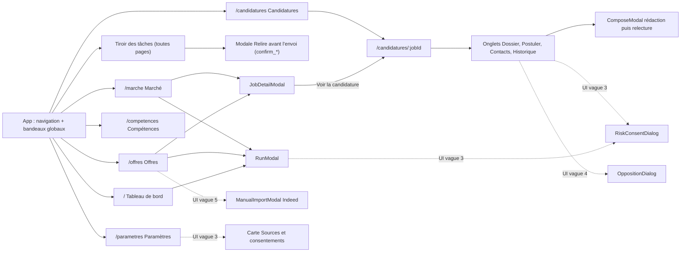

# Routage, Pages & Navigation

> Vérifié dans `src/main.tsx` (`BrowserRouter`), `src/App.tsx` (`<Routes>`, menu `NAV`), `web/app.py`
> (route de repli SPA) et les pages. Bibliothèque : **`react-router-dom` 6.30.6** (navigation par routeur, pas
> par état local), mode « déclaratif » (`<Routes>` / `<Route>`), sans *loaders* ni *data router*.

## 1. Arborescence des Routes

### 1.1 Routes `[ACTUEL]`

| Route | Composant | Menu | Rôle |
| :--- | :--- | :--- | :--- |
| `/` | `Dashboard` | « Tableau de bord » (`end`) | Session LinkedIn, quotas du jour, dernière analyse, entonnoir de candidature, tâches actives, activité 14 jours, erreurs récentes, derniers événements. Bouton « Lancer une analyse ». |
| `/offres` | `Jobs` | « Offres » | Tableau des offres du **dernier** rapport, filtres, annotation, entraînement, recalcul ; `JobDetailModal`. |
| `/candidatures` | `Applications` | « Candidatures » | Liste maître ; redirige (`replace`) vers la première candidature s'il en existe. |
| `/candidatures/:jobId` | `Applications` | (même entrée active) | Détail : onglets Dossier, Postuler, Contacts (n), Historique ; sélecteur de statut. `jobId` encodé par `encodeURIComponent` (les identifiants contiennent `:`, ex. `job:111`). |
| `/marche` | `Market` | « Marché » | Rapport choisi (le plus récent par défaut) : Synthèse, Offres à cibler, Compétences, Analyse, Signaux ; navigation interne par ancres (`scrollIntoView`), sans changement d'URL. |
| `/competences` | `Skills` | « Compétences » | Profil candidat : compétences, identité professionnelle, suggestions (manquantes, en hausse), import LinkedIn, recalcul. |
| `/parametres` | `SettingsPage` | « Paramètres » | Recherche par défaut, plafonds, coordonnées, signature, réponses mémorisées, état du `.env`, email de test. |
| `*` | `<Navigate to="/" replace />` | — | Toute autre URL revient au tableau de bord. |

Hors routeur (ouverts dans un nouvel onglet via `authedUrl`, donc jeton en paramètre `?token=`) :
`/api/reports/{name}/html` (« Rapport complet », CSP `sandbox allow-scripts allow-popups`),
`/api/reports/{name}` (export JSON, attribut `download`), `/api/applications/{id}/cv.html` (« Version
imprimable / PDF », CSP `sandbox allow-scripts allow-modals allow-popups`).

**Repli serveur** : `GET /{path}` de FastAPI renvoie `index.html` (avec jeton injecté, `Cache-Control: no-store`)
pour tout chemin hors `/api/` qui n'est pas un fichier de `dist/` ⇒ les liens profonds et le rechargement
fonctionnent. Sans `dist/`, page 503 « Interface non compilée ».

### 1.2 Arborescence des pages et modales



### 1.3 Évolutions `[CIBLE]`
> **`[ACTUEL]` côté UI (revue du 2026-10-09 ; backend des vagues 3-4 encore `[CIBLE]`)** :
> - Paramètres : carte « Sources et consentements » (`#sources`, défilement vers l'ancre une fois les sources
>   chargées) : mode d'accès, « bientôt » si `enabled = false`, identifiants France Travail, version et date du
>   consentement, « nouvelle version à relire », « Lire les risques », « Révoquer » (modale de confirmation) ;
>   l'option « Aucune » de l'interprète a disparu (G-4).
> - Candidatures › Contacts : badge « Opposé », bouton « Ce contact refuse d'être recontacté » (`OppositionDialog`),
>   champs Email / Profil d'un contact opposé désactivés, « Écrire » désactivé ; origine de l'adresse affichée à la
>   relecture du message.
> - Filtres dans l'URL : `/offres?q=&min_score=&label=&status=`, `/marche?rapport={name}`.
> - Bandeaux de blocage par source (`BlockBanners`, d'après `GET /api/sources`, repli sur `/api/status.blocked` si
>   `/sources` échoue : V4-5) ; bouton « Lever le blocage » par source.
> - Bandeau « Relancer : {action} » après acceptation des risques sur un 428 (`ConsentGate`).
> `[ACTUEL]` depuis les vagues 5 et 6 : « Importer une offre » (Indeed, `ManualImportModal`, ouvert depuis le
> `SourcePicker` du lancement d'analyse), badge **Source** et filtre par source, libellé « Ouvrir l'offre »,
> `InterpreterBadge` dans l'en-tête de Marché et la section « Analyse », bandeau de blocage nommant les sources ;
> Paramètres : champs « Ton lieu de résidence » et « Ton fuseau horaire », avertissement Claude mis à jour
> (`[personne]`, I-11) ; tableau de bord : libellé « Purge de rétention » pour les tâches `purge`.


Aucune nouvelle route n'est nécessaire ; les nouveautés s'intègrent aux pages existantes :
- **Paramètres** : nouvelle carte « Sources et consentements » (ancre `#sources`) — par source : libellé, mode
  d'accès (`api_officielle` / `navigateur` / `import_manuel`), état (activée, identifiants France Travail
  configurés), version de risques acceptée et date, boutons « Lire les risques » / « Révoquer » (cf.
  `02-components-catalog.md` § 4.1) ; l'option « Aucune » de l'interprète disparaît (I-11).
- **Offres** : bouton « Importer une offre » (Indeed, `ManualImportModal`) ; colonne / badge **Source**
  (`source_code`) ; le lien « Ouvrir sur LinkedIn » devient « Ouvrir l'offre » (libellé selon la source).
- **Marché** : `InterpreterBadge` dans l'en-tête ; filtre par source si plusieurs sources dans le rapport.
- **Candidatures › Contacts** : origine de l'adresse, badge « Opposé », `OppositionDialog`.
- **Filtres dans l'URL** : `/offres?q=&min_score=&label=&status=`, `/marche?rapport={name}` (lien direct vers un
  rapport, bouton Retour du navigateur cohérent).
- **Bandeau de blocage** générique par source (« {Source} a interrompu la navigation… ») au lieu du texte figé
  « LinkedIn ».

**Terminologie** : le menu et la page s'appellent « **Paramètres** » (route `/parametres`) ; le lot 1 parle de
« Réglages » (matrice § 3 : « Réglages → « Importer » »). Le libellé de l'UI est conservé ; « Réglages » dans le
lot 1 désigne cette page. Par ailleurs, « Importer depuis LinkedIn » se trouve sur la page **Compétences**, pas
dans Paramètres.

## 2. Guards & Middlewares de Navigation

- **Pas d'authentification utilisateur ni de RBAC** `[ACTUEL]` : instance mono-utilisateur, aucune page de
  connexion, aucune route protégée côté client. La protection est **côté serveur** (middleware `guard` de
  `web/app.py`) : `Host` local, `Origin` identique pour les méthodes mutatives, jeton `X-Local-Token` comparé en
  temps constant (lot 1, `04-infrastructure-and-deployment.md` § 5).
- **Garde par l'état** `[ACTUEL]` : plutôt que bloquer une route, l'UI désactive les actions selon `useStatus()` :
  - `credentials_configured = false` → bandeau global `warning` + boutons navigateur désactivés (Postuler,
    Chercher les recruteurs) ;
  - `blocked` non nul → bandeau global `danger` avec lien « lève le blocage » + mêmes boutons désactivés ;
  - quotas atteints (`quotas.apply`, `quotas.messages`) → « Lancer la candidature » et « Relire avant l'envoi »
    désactivés ;
  - `smtp_configured = false` → canal Email bloqué dans `ComposeModal`, bouton d'email de test masqué.
  `RunModal` n'applique aucune de ces gardes : identifiants absents ou blocage actif ⇒ 409 affiché après clic.
  `[CIBLE]` même garde préventive dans `RunModal` (case « Collecter » désactivée avec explication).
- **Garde de consentement** `[ACTUEL]` côté UI (backend `[CIBLE]`, vague 3) : pas de route ; popup de risques
  **préventive** (`RunModal` pour les sources cochées, `useConsentGuard()` pour « Lancer la candidature »,
  « Chercher les recruteurs », « Importer depuis LinkedIn », ajout de compétence si `linkedin_skill_sync`, relecture
  et envoi d'un message LinkedIn) et, sur réponse 428, popup globale `ConsentGate` sans rejeu (cf. `02` § 4.1).
- **Jeton périmé** `[ACTUEL]` (vague 2) : sur 401, bandeau global « Le jeton local a changé : recharge la page »
  + « Recharger », requêtes et interrogations suspendues.
- **Quitter une page avec une saisie non enregistrée** : aucune protection `[ACTUEL]` (Dossier, Contacts,
  Paramètres) — Contacts signale seulement « Enregistre d'abord les contacts » sur le bouton « Écrire ».
  `[CIBLE]` indicateur « Modifications non enregistrées » sur la carte et `beforeunload` tant qu'un formulaire
  est modifié (pas de `useBlocker`, réservé aux *data routers*).

## 3. SEO, Titres & Métadonnées

> **Vague 7, partie 1 `[ACTUEL]`** : `noindex` ; titre « {Section} · LinkedIn Market » posé par `App.tsx` ;
> `React.lazy` pour `Market` ; focus programmatique sur le `<h1>` **au changement de section** seulement (pas entre
> deux candidatures de la même page : décision 2026-10-08, évite de perdre la position dans la liste).
> **Vague 7, partie 2 `[ACTUEL]`** : lien d'évitement « Aller au contenu » (`#contenu`, `<main tabIndex=-1>`).
> Reste `[CIBLE]` : titre détaillé par candidature et préfixe « (1) Réponse attendue — ».


- **SEO** : sans objet (application locale, jamais indexée). `<meta name="robots" content="noindex">` `[ACTUEL]`.
- **Titre de document** : avant la vague 7, unique et statique ; depuis, « {Section} · LinkedIn Market » posé par
  `useRouteAnnouncements()` d'`App.tsx` `[ACTUEL]` (2.4.2 satisfait par section). Reste `[CIBLE]` le titre détaillé :
  `useDocumentTitle(titre)` dans chaque page : « {Titre de la page} · LinkedIn Market » (ex. « Candidature —
  Senior Python Developer · LinkedIn Market ») ; en `attente_saisie`, préfixe « (1) Réponse attendue — » pour
  attirer l'attention depuis un autre onglet.
- **Langue** : `<html lang="fr">` `[ACTUEL]` ; contenus d'offres en anglais non balisés (acceptable, 3.1.2 AA
  concerne les passages : `[CIBLE]` `lang` sur le texte d'offre si la langue détectée diffère).
- **Écrans blancs** `[ACTUEL]` : `React.lazy` pour `Market` avec `Suspense` (squelette `role="status"`), états
  « Chargement… » par page, morceaux séparés React / Zod / Markdown (`manualChunks`).
- **Focus à la navigation** `[ACTUEL]` (vague 7) : au changement de **section**, focus sur le `<h1 tabIndex=-1>`
  de la page (attente du `<h1>` de Marché chargé à la demande, 3 s au plus) ; lien d'évitement « Aller au contenu »
  avant la navigation (2.4.1, A).
- **Landmarks** `[ACTUEL]` : `<nav aria-label="Navigation">`, `<main>`, `<aside aria-label="Tâches">`,
  `<nav aria-label="Sections de la page">` (Marché) ; le lien actif est stylé par `NavLink` qui pose
  automatiquement `aria-current="page"`.

## 4. Outillage, Versions & Migrations

### 4.1 Pile actuelle `[ACTUEL]` (`package.json`, versions résolues dans `node_modules`)
> Vague 2 : `zod` `^4.6.5` ajouté ; découpage du bundle par `build.rollupOptions.output.manualChunks` dans
> `vite.config.ts` (React, Zod, Markdown en morceaux séparés), autorisé le 2026-10-09.


| Paquet | Déclaré | Installé |
| :--- | :--- | :--- |
| `react`, `react-dom` | `^18.3.1` | 18.3.1 |
| `react-router-dom` | `^6.28.0` | 6.30.6 |
| `@tanstack/react-query` | `^5.101.2` | 5.104.1 |
| `react-markdown` / `remark-gfm` | `^10.1.0` / `^4.0.1` | 10.1.0 |
| `vite` / `@vitejs/plugin-react` | `^6.0.3` / `^4.3.4` | 6.4.4 / 4.7.0 |
| `typescript` | `^5.6.3` | 5.9.3 |
| `tailwindcss` (+ `postcss`, `autoprefixer`) | `^3.4.15` | 3.4.19 |

Scripts : `dev` (Vite, port **5174**, proxy `/api` → `http://127.0.0.1:8765`), `build` (`tsc --noEmit && vite
build`), `preview`, `lint` (`eslint src`) `[ACTUEL]` : ESLint 9 en configuration plate (`eslint.config.js`),
**0 erreur, 0 avertissement** depuis la vague 2 (revérifié le 2026-10-09 ; plus aucune exception par fichier).
Dépendances ajoutées : `zod` `^4.6.5` (vague 2) ; police Inter auto-hébergée (`@fontsource-variable/inter`, cf.
`01` § 1.3).

### 4.2 Versions stables au 8 octobre 2026 (registre npm et annonces officielles)

| Outil | Dernière stable | Remarque |
| :--- | :--- | :--- |
| React | 19.3.0 | Le projet est sur la branche 18. |
| React Router | 7.18.4 (`react-router`) | En v7, `react-router-dom` n'est plus qu'une réexportation de `react-router`. |
| TanStack Query | 5.104.1 | À jour. |
| Vite | 8.3.3 | Vite 8 utilise Rolldown ; Node 20.19+ / 22.12+. |
| TypeScript | 7.0.2 | Compilateur natif (Go) livré dans le paquet `typescript`, 8 à 12× plus rapide. |
| Tailwind CSS | 4.3.3 | Configuration en CSS (`@theme`), navigateurs Safari 16.4+, Chrome 111+, Firefox 128+. |
| ESLint | 10.12.0 | Configuration **plate uniquement** (`eslint.config.js`) ; `.eslintrc` supprimé. |
| typescript-eslint / eslint-plugin-react-hooks | 8.71.1 / 7.1.1 | |
| Zod | 4.6.5 | Cf. `05-forms-and-validation.md`. |

### 4.3 Recommandations `[CIBLE]`
> État au 2026-10-09 : la recommandation 1 (ESLint) est `[ACTUEL]` et sa dette soldée (0 / 0, aucune exception
> `warn` restante) ; Zod 4 est installé (`src/schemas.ts`). Les montées de version 2 à 4 restent optionnelles et
> non planifiées.

1. **Fait (vague 0) `[ACTUEL]` — ESLint (configuration plate)** : ajouter `eslint`, `@eslint/js`, `typescript-eslint`,
   `eslint-plugin-react-hooks`, `eslint-plugin-jsx-a11y` et `globals` ; script `"lint": "eslint src"` ; fichier :
   ```js
   // eslint.config.js
   import js from "@eslint/js";
   import tseslint from "typescript-eslint";
   import reactHooks from "eslint-plugin-react-hooks";
   import jsxA11y from "eslint-plugin-jsx-a11y";
   import globals from "globals";

   export default tseslint.config(
     { ignores: ["dist"] },
     js.configs.recommended,
     ...tseslint.configs.recommended,
     reactHooks.configs.recommended,   // détecte le bug de SettingsPage (rules-of-hooks)
     jsxA11y.flatConfigs.recommended,
     { files: ["src/**/*.{ts,tsx}"], languageOptions: { globals: globals.browser } },
   );
   ```
   La forme exacte des exports de configuration des greffons (`configs.recommended` vs
   `configs["recommended-latest"]`) est à vérifier à l'installation selon les versions retenues.

   **Vérifié le 2026-10-08 (brief vague 0)** : `eslint-plugin-jsx-a11y` 6.10.2 (dernière) n'accepte qu'ESLint ≤ 9
   (conflit de pair avec ESLint 10) ⇒ épingler `eslint@^9.39` et `@eslint/js@^9.39` ; `typescript-eslint` 8.71,
   `eslint-plugin-react-hooks` 7.1 (`reactHooks.configs.flat.recommended`), `globals` 17. Le préréglage
   `react-hooks` 7 active les règles du compilateur React. Résultat sur le code existant : 10 erreurs, dont le bug
   réel `rules-of-hooks` de `SettingsPage.tsx` (à corriger, la règle reste `error`).
   **Mise à jour vague 7, partie 1** : toutes les règles sont remontées en `error` ; seule exception,
   `react-hooks/set-state-in-effect` reste en `warn` **pour `src/pages/Applications.tsx` uniquement** (2 occurrences,
   l.17 et l.103), à corriger en vague 7 partie 2 avec la migration des onglets du Détail.
   Dette initiale (vague 0, pour mémoire) :
   | Règle | Occurrences au 2026-10-08 |
   | :--- | :--- |
   | `react-hooks/set-state-in-effect` | 6 : `TaskDrawer.tsx:109`, `Applications.tsx:17` et `:103`, `Market.tsx:21`, `SettingsPage.tsx:11`, `Skills.tsx:15` |
   | `jsx-a11y/no-autofocus` | 1 : `RunModal.tsx:45` |
   | `jsx-a11y/no-static-element-interactions` | 1 : `ui.tsx:109` (fond de modale cliquable) |
   | `jsx-a11y/no-noninteractive-element-interactions` | 1 : `ui.tsx:110` |
2. **Optionnel — React 18 → 19** : faible coût (pas de `forwardRef`, `defaultProps`, `propTypes` ni refs en
   chaîne dans le code) ; bénéfice : `ref` en prop simple (utile pour le piège de focus des modales), support des
   métadonnées `<title>` rendues dans les composants (titre par page sans hook). À faire avec
   `@types/react` 19 et React Router 7 dans le même lot.
3. **Optionnel — Tailwind 3 → 4** : `npx @tailwindcss/upgrade` ; les jetons `withOpacity` deviennent des
   variables `@theme` (`--color-surface: rgb(var(--color-surface-rgb))`) et l'opacité passe par `color-mix()`.
   Justification : outil moins lourd (moteur Oxide), suppression de PostCSS/Autoprefixer. Contrainte : navigateurs
   récents uniquement — acceptable (l'utilisateur pilote déjà un Chrome / Firefox récent). À faire **après** la
   correction des contrastes pour ne pas mélanger deux changements visuels.
4. **Optionnel — Vite 6 → 8 et TypeScript 5.9 → 7** : gain de vitesse de build ; prérequis Node ≥ 22.12 (le lot 1
   impose déjà Node 22 LTS). Vérifier `@vitejs/plugin-react` compatible.
5. **À ne pas faire** : migrer vers un *framework* (Next.js, Remix) — une SPA servie par FastAPI en local suffit.
