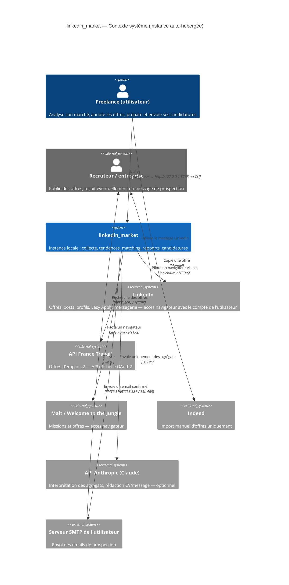
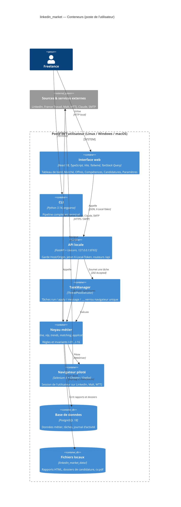

# Vue d'Ensemble du Système & Architecture

## 1. Style Architectural Global

| Dimension | Choix | Statut |
| :--- | :--- | :--- |
| Modèle général | **Monolithe modulaire Python**, mono-processus, distribué en **open source auto-hébergé** (une instance = un utilisateur, sur son poste). Pas de microservices, pas de broker. | `[ACTUEL]` |
| Points d'entrée | CLI `python -m linkedin_market` (pipeline complet, saisie interactive) et interface web `python -m linkedin_market.web` (http://127.0.0.1:8765). Les deux appellent les mêmes fonctions de `pipeline.py` (aucune saisie ni `sys.exit` dans `pipeline`). | `[ACTUEL]` |
| Backend | **FastAPI** (≥ 0.115) servi par **Uvicorn**, routeurs sous `/api` (`core`, `jobs`, `applications`). Swagger uniquement en `--dev`. | `[ACTUEL]` |
| Frontend | SPA **React 18 + TypeScript 5 + Vite 6 + Tailwind CSS 3 + TanStack Query 5**, compilée dans `web/frontend/dist` et servie par FastAPI. | `[ACTUEL]` |
| Tâches longues | `TaskManager` en mémoire : `ThreadPoolExecutor`, un verrou partagé pour les tâches navigateur (un seul Selenium à la fois), suivi par *polling* de `/api/tasks/{id}`. | `[ACTUEL]` |
| Automatisation navigateur | **Selenium 4.22** (Chrome puis Firefox, Selenium Manager pour les drivers). | `[ACTUEL]` |
| Analyse | NumPy (TF-IDF, n-grammes, régression logistique par descente de gradient) — aucune dépendance ML lourde. | `[ACTUEL]` |
| IA | **Claude** via SDK `anthropic` (modèle par défaut `claude-opus-5-5`, surchargeable par `ANTHROPIC_MODEL`), **optionnel** : l'interprète local à base de règles produit toujours une interprétation. | `[ACTUEL]` |
| Persistance | Fichiers JSON / JSONL dans `linkedin_market_data/` (écriture atomique `tmp` + `os.replace`). | `[ACTUEL]` → à remplacer |
| Persistance cible | **PostgreSQL 18** via **SQLAlchemy 2.x** (ORM, style `Mapped[]`), driver **psycopg 3**, migrations **Alembic**. Lancé localement (paquet système ou `docker compose`). | `[CIBLE]` |
| Langage | **Python 3.14** (minimum requis), typage complet, linter **ruff** 0.16 (`linkedin_market/ruff.toml`, `requirements-dev.txt` ; dette initiale de 224 avertissements). | `[ACTUEL]` |

### Pourquoi pas de Redis / Celery
Une instance sert un seul utilisateur et un seul navigateur à la fois : une file distribuée n'apporterait que de la
complexité d'installation. Après la migration, l'état des tâches est persisté dans la table `tasks` ; le
`ThreadPoolExecutor` reste l'exécuteur. Une tâche `en_cours` trouvée au démarrage est marquée `échec`
(« interrompue par l'arrêt de l'application »).

## 2. Diagramme C4 — Niveau Contexte

## 3. Diagramme C4 — Niveau Conteneurs (cible)

## 4. Découpage en Modules (paquet `linkedin_market/`)

| Couche | Modules | Responsabilité |
| :--- | :--- | :--- |
| Entrées | `__main__.py`, `web/__main__.py`, `web/app.py`, `web/routers/*` | Parsing CLI / HTTP, validation Pydantic, codes HTTP. Aucune règle métier. |
| Orchestration | `pipeline.py`, `web/services.py`, `web/tasks.py`, `web/guards.py` | Enchaîner les étapes, gérer annulation, saisies et vérifications manuelles, plafonds et blocages. |
| Domaine | `nlp.py`, `trends.py`, `matching.py`, `profile.py`, `application.py`, `report.py`, `interpreter.py`, `settings.py` | Calculs et règles, sans I/O réseau. |
| Intégrations | `browser.py`, `session.py`, `scraper.py`, `apply_bot.py`, `contacts.py`, `outreach.py`, `profile_sync.py`, `cv_pdf.py` ; `sources/france_travail.py` `[CIBLE]` | Accès aux systèmes externes ; lèvent des exceptions métier lisibles (`BlockedError`, `OutreachError`, `ProfileSyncError`). |
| Persistance | `storage.py`, `activity.py`, `config.py` ; `db/models.py`, `db/session.py`, `db/repositories/*`, `db/import_json.py`, `migrations/` (Alembic) `[CIBLE]` | Lecture / écriture des données ; seul endroit autorisé à toucher la base ou `DATA_DIR`. |

Règle de dépendance : `Entrées → Orchestration → Domaine / Intégrations → Persistance`. Le domaine n'importe
jamais FastAPI ni Selenium ; les routeurs n'importent jamais Selenium.

## 5. Frontières et Responsabilités

- **Frontend** : rendu, capture des intentions, validations de forme (champs requis, bornes numériques),
  **popup de risques** avant la première utilisation d'une source navigateur, **écran de relecture** avant tout
  envoi, suivi des tâches par polling. Ne détient aucun secret hormis le jeton local injecté dans `index.html`.
- **API locale** : seul garant des invariants (plafonds, blocage, consentement, opposition, non-régression des
  statuts). Refuse toute requête dont l'`Host` n'est pas `127.0.0.1`, `localhost` ou `[::1]`, ou dont l'`Origin`
  diffère (sauf origines Vite `:5174` en `--dev`).
- **Navigateur piloté** : exécute exclusivement des actions que l'utilisateur pourrait faire à la main, au rythme
  de la prudence, avec son propre compte ; s'arrête au premier signe de blocage.
- **Systèmes externes** : Claude n'est qu'un rédacteur optionnel (agrégats, CV, message) ; le SMTP est celui de
  l'utilisateur ; France Travail est la seule source à API officielle.
