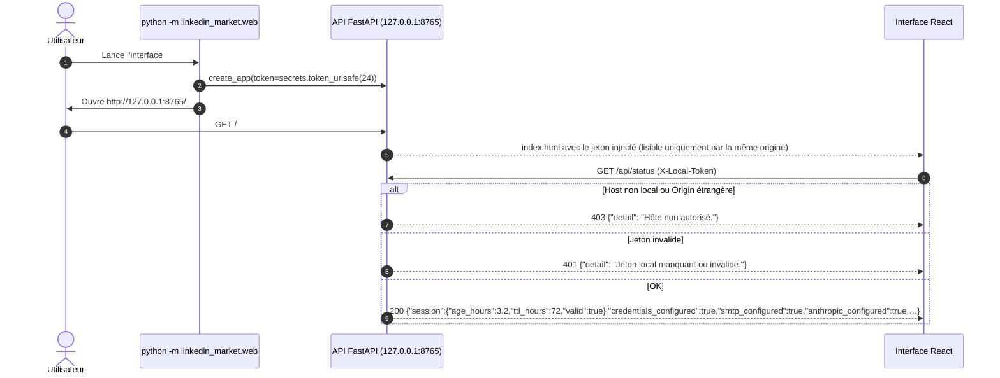
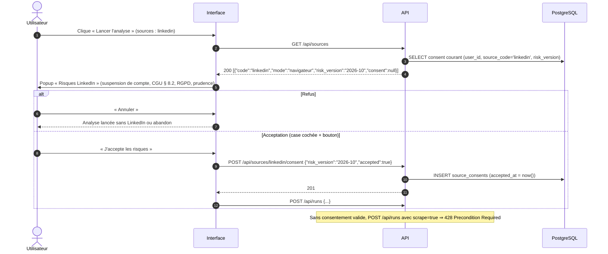
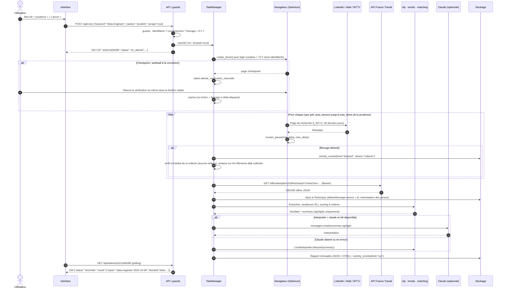
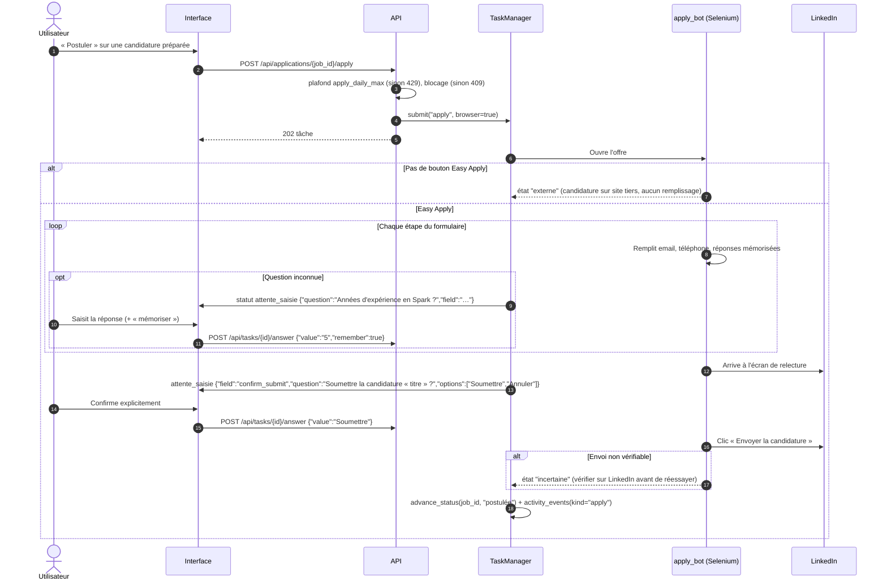
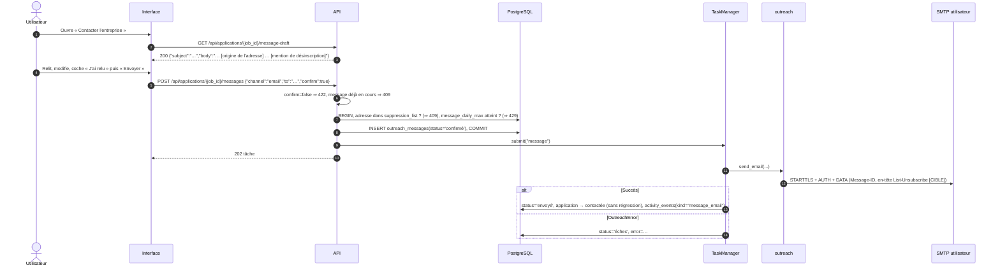

# Flux de Données & Diagrammes de Séquence

Conventions communes à tous les flux :
- Toute requête mutative porte l'en-tête `X-Local-Token` (ou `?token=` pour les liens ouverts dans un nouvel
  onglet). Absent ou invalide ⇒ `401`. `Host` non local ⇒ `403`. `Origin` étrangère ⇒ `403`.
- Une action longue renvoie `202 Accepted` + l'objet tâche ; le frontend interroge `GET /api/tasks/{id}` toutes les
  1,5 s tant que le statut n'est pas final (`terminée`, `échec`, `annulée`).
- Statuts de tâche : `en_attente` → `en_cours` ⇄ `attente_saisie` / `attente_verification_manuelle` →
  `terminée` | `échec` | `annulée`.

## 1. Flux Critique 1 : Accès à l'Interface Locale

## 2. Flux Critique 2 : Acceptation des Risques d'une Source `[CIBLE]`

## 3. Flux Critique 3 : Analyse du Marché (`kind="run"`)

Décision E-4 (2026-10-08, option A) : un blocage pendant la collecte n'empêche pas le rapport. La tâche finit
`terminée` avec un **rapport partiel** (données déjà collectées + historique de 30 jours) et
`result.blocked = true`, `result.blocked_where = "collecte"` ; l'interface affiche « Collecte interrompue par
LinkedIn ». I-06 reste entier : arrêt immédiat, événement `blocked`, repos de 6 h, aucune relance.

## 4. Flux Critique 4 : Candidature Simplifiée (`kind="apply"`)

## 5. Flux Critique 5 : Message de Prospection (`kind="message"`)

## 6. Événements du Journal d'Activité

Le journal (`activity.jsonl` aujourd'hui, table `activity_events` demain) sert au monitoring, aux plafonds
quotidiens et aux périodes de repos. Un événement = `{at, kind, ...data}`.

| `kind` | Émis par | Données | Consommé par |
| :--- | :--- | :--- | :--- |
| `run` | `services.run_analysis` | `keyword`, `scrape`, `jobs` | `/api/monitor` |
| `apply` | `services.apply_job` | `job`, `title` | plafond `apply_daily_max` |
| `message_email`, `message_linkedin` | `services.send_message` | `job`, `to` | plafond `message_daily_max` |
| `profile_skill` | `services.add_skill` | `skill`, `linkedin_name` | `/api/monitor` |
| `blocked` | toute action navigateur | `where`, `job?` (la fin du repos `until` est calculée à la lecture par `block_status()`) | `guard_not_blocked()` (repos 6 h) |
| `unblocked` | `POST /api/block/clear` | — | lève le repos en cours |
| `error` | erreurs non métier | `message` | `/api/monitor` |

## 7. Résilience & Gestion des Pannes

| Situation | Comportement |
| :--- | :--- |
| Chargement de page navigateur | `set_page_load_timeout(60)` ; échec ⇒ tâche `échec`, message lisible. |
| Saisie utilisateur attendue | `INPUT_TIMEOUT_SECONDS = 600` ; au-delà ⇒ tâche `échec`. |
| Blocage plateforme | Arrêt immédiat, événement `blocked`, repos de **6 h** (`BLOCK_COOLDOWN_HOURS`) ; levée manuelle uniquement après vérification du compte dans un navigateur normal. |
| Claude indisponible / erreur | Bascule automatique sur `LocalInterpreter` ; le rapport indique `interpreter_used="local"`. |
| API France Travail | Timeout 10 s, 3 tentatives avec backoff exponentiel (1 s, 2 s, 4 s) sur `429` / `5xx` ; respect de `Retry-After` ; en échec, l'analyse continue avec les autres sources. `[CIBLE]` |
| SMTP | Timeout 25 s (`SMTP_TIMEOUT`), **aucune** relance automatique (éviter les doublons) ; statut `échec` et nouvel envoi manuel. |
| Arrêt de l'application pendant une tâche | `[ACTUEL]` (vague 1) : au redémarrage, les tâches non finales de la table `tasks` sont marquées `échec` (« Tâche interrompue par l'arrêt de l'application. »). |
| Annulation | `POST /api/tasks/{id}/cancel` ; vérifiée entre deux sources / deux étapes (`Cancelled`). |
