# Schéma Entité-Relation (ERD)

> **Statut** : schéma **PostgreSQL 18** `[ACTUEL]` depuis la vague 1 (SQLAlchemy 2.x + Alembic, révision
> `migrations/versions/0001_initial.py`, puis `0002` à `0004` (vagues 4 à 6), modèles `db/models.py`). La section 4 indique, pour chaque table, le fichier
> JSON/JSONL de `linkedin_market_data/` qu'elle remplace et la règle d'import (`db/import_json.py`). Colonnes et
> tables annoncées pour une vague ultérieure : marquées `[CIBLE]`.

Conventions :
- Clés primaires `uuid` générées par `uuidv7()` (PostgreSQL 18, ordonnées dans le temps) sauf mention contraire.
- Toutes les dates en `timestamptz` (UTC). `created_at` / `updated_at` `NOT NULL DEFAULT now()`.
- Énumérations stockées en `text` + contrainte `CHECK` (pas de type `ENUM` PostgreSQL : évolution sans migration
  bloquante). Valeurs en français, sans majuscules, identiques au code.
- Chaque table métier porte `user_id uuid NOT NULL REFERENCES users(id) ON DELETE CASCADE` (I-01).
- Les colonnes `jsonb` ne contiennent que des données sans contrainte relationnelle (paramètres, agrégats, poids).

## 1. Diagramme Entité-Relation

```mermaid
erDiagram
    USERS ||--|| USER_SETTINGS : "configure"
    USERS ||--o| CANDIDATE_PROFILES : "possède"
    USERS ||--o{ PROFILE_SKILL_OVERRIDES : "surcharge"
    USERS ||--o{ MEMORIZED_ANSWERS : "mémorise"
    USERS ||--o{ SOURCE_CONSENTS : "accepte"
    SOURCES ||--o{ SOURCE_CONSENTS : "concerne"
    USERS ||--o{ PLATFORM_SESSIONS : "ouvre"
    SOURCES ||--o{ PLATFORM_SESSIONS : "sur"
    USERS ||--o{ TASKS : "lance"
    USERS ||--o{ COLLECTED_ITEMS : "collecte"
    SOURCES ||--o{ COLLECTED_ITEMS : "provient de"
    TASKS |o--o{ COLLECTED_ITEMS : "produit"
    COLLECTED_ITEMS ||--o| LABELS : "annotée par"
    USERS ||--o{ MATCHING_MODELS : "entraîne"
    USERS ||--o{ REPORTS : "produit"
    TASKS |o--o| REPORTS : "génère"
    COLLECTED_ITEMS ||--o| APPLICATIONS : "fait l'objet de"
    USERS ||--o{ APPLICATIONS : "suit"
    APPLICATIONS ||--o{ APPLICATION_EVENTS : "historise"
    APPLICATIONS ||--o{ COMPANY_CONTACTS : "rattache"
    APPLICATIONS ||--o{ OUTREACH_MESSAGES : "déclenche"
    COMPANY_CONTACTS |o--o{ OUTREACH_MESSAGES : "destinataire"
    USERS ||--o{ SUPPRESSION_LIST : "respecte"
    USERS ||--o{ ACTIVITY_EVENTS : "journalise"
    USERS ||--o{ LEGACY_IMPORTS : "a importé"

    USERS {
        uuid id PK
        text email UK "adresse de l'utilisateur, minuscule"
        text display_name
        timestamptz created_at
        timestamptz updated_at
    }

    USER_SETTINGS {
        uuid user_id PK,FK
        text keyword
        text location "vide = monde entier"
        boolean remote_only "défaut true"
        text caution "prudent (défaut)|normal|agressif"
        int max_items "1 au plafond de la prudence, NULL = plafond"
        text profile_source "auto|file|linkedin"
        text interpreter "claude|local"
        numeric apply_min_score "0-100, défaut 70"
        int apply_daily_max "0-200, défaut 10"
        int message_daily_max "0-200, défaut 15"
        text contact_email
        text contact_phone
        text full_name "en-tête du CV ATS, vide par défaut (révision 0006)"
        text linkedin_url "URL /in/ ou vide (révision 0006)"
        text signature
        boolean linkedin_skill_sync "défaut true"
        text home_location "vide par défaut (vague 6, révision 0004)"
        text timezone "IANA ou vide (vague 6, révision 0004)"
        timestamptz updated_at
    }

    CANDIDATE_PROFILES {
        uuid id PK
        uuid user_id FK,UK
        text origin "chemin du fichier ou linkedin"
        text title "surcharge utilisateur, vide = aucune"
        text text "cache du profil LinkedIn importé"
        text_array skills "cache des compétences extraites de text"
        int years_experience "surcharge, 0-60, NULL = aucune"
        text seniority "surcharge : junior|confirme|senior|lead|vide"
        timestamptz synced_at
        timestamptz updated_at
    }

    PROFILE_SKILL_OVERRIDES {
        uuid user_id PK,FK
        text skill PK "forme normalisée"
        text action "ajoutée|retirée"
        timestamptz created_at
    }

    MEMORIZED_ANSWERS {
        uuid user_id PK,FK
        text question_key PK "question normalisée"
        text answer
        timestamptz updated_at
    }

    SOURCES {
        text code PK "linkedin|france_travail|malt|wttj|indeed"
        text label
        text access_mode "api_officielle|navigateur|import_manuel"
        text risk_version "ex. 2026-10, NULL si sans popup"
        boolean enabled "toutes à true depuis la révision 0003 (vague 5)"
    }

    SOURCE_CONSENTS {
        uuid id PK
        uuid user_id FK
        text source_code FK
        text risk_version
        timestamptz accepted_at
        timestamptz revoked_at "NULL = actif"
    }

    PLATFORM_SESSIONS {
        uuid user_id PK,FK
        text source_code PK,FK
        bytea cookies_encrypted "Fernet(LM_SECRET_KEY)"
        timestamptz last_login_at "connexion par identifiants"
        timestamptz expires_at "last_login_at + 72 h"
    }

    TASKS {
        uuid id PK
        uuid user_id FK
        text kind "run|rescore|train|prepare|apply|contacts|message|import_profile|profile_skill|purge (interne)"
        text title
        text status "en_attente|en_cours|attente_saisie|attente_verification_manuelle|terminée|échec|annulée"
        boolean browser
        jsonb params
        jsonb result
        text error
        jsonb needs_input "question en attente"
        jsonb meta "ex. job_id, clé de dédoublonnage"
        text_array logs "400 dernières lignes"
        timestamptz created_at
        timestamptz started_at
        timestamptz finished_at
    }

    COLLECTED_ITEMS {
        uuid id PK
        uuid user_id FK
        text source_code FK
        text kind "job|post|person"
        text external_id "identifiant chez la source"
        uuid task_id FK "NULL si import manuel"
        text url
        text title
        text text "NULL pour person (I-09)"
        text_array skills "extraites à l'ingestion"
        text_array keywords "mots-clés de collecte, lower(trim), sans doublon, fusionnés à la recollecte"
        text company
        text location
        date posted_at "approximée depuis il y a 3 j"
        timestamptz collected_at
        timestamptz purge_after "I-10"
    }

    LABELS {
        uuid item_id PK,FK
        uuid user_id FK
        smallint value "0|1"
        timestamptz labeled_at
    }

    MATCHING_MODELS {
        uuid id PK
        uuid user_id FK
        int version "incrémental par utilisateur"
        jsonb weights "{weights[8], bias, mean[8], std[8], train_accuracy, loss_history}"
        jsonb feature_names
        int n_positive
        int n_negative
        boolean learned "false = poids a priori"
        boolean is_active
        timestamptz trained_at
    }

    REPORTS {
        uuid id PK
        uuid user_id FK
        uuid task_id FK
        text slug UK "(user_id, slug) ; mot-cle-AAAA-MM-JJ[-n], date locale"
        text keyword
        jsonb summary "agrégats + offres scorées"
        text interpretation
        text interpreter_used "claude|local"
        text html_path "relatif à DATA_DIR, ex. reports/x.html"
        timestamptz created_at
    }

    APPLICATIONS {
        uuid id PK
        uuid user_id FK
        uuid item_id FK,UK "offre"
        text status "préparée|contactée|postulée|entretien|refusée|abandonnée|externe|échec"
        text apply_state "dernier résultat du bot"
        numeric score
        text generator "claude|local"
        text folder_path "relatif à DATA_DIR"
        timestamptz prepared_at
        timestamptz updated_at
    }

    APPLICATION_EVENTS {
        bigint id PK "identity"
        uuid application_id FK
        text kind "status|apply|message|contacts|note"
        jsonb details
        timestamptz at
    }

    COMPANY_CONTACTS {
        uuid id PK
        uuid user_id FK
        uuid application_id FK
        text full_name "name dans le code actuel (E-15)"
        text headline "fonction affichée"
        text profile_url
        text email "NULL si non affiché par la source"
        text source "linkedin_equipe_recrutement|manuel"
        text legal_basis "interet_legitime"
        timestamptz collected_at
        timestamptz last_contacted_at
        timestamptz purge_after "dernier contact + 3 ans (I-14)"
        timestamptz opposed_at "NULL = pas d'opposition ; email/URL effacés à l'opposition (vague 4, révision 0002)"
    }

    OUTREACH_MESSAGES {
        uuid id PK
        uuid user_id FK
        uuid application_id FK
        uuid contact_id FK "NULL si adresse saisie"
        text channel "email|linkedin"
        text recipient
        text subject
        text body
        boolean cv_attached
        text status "confirmé|envoyé|échec"
        text smtp_message_id
        text error
        timestamptz confirmed_at
        timestamptz sent_at
    }

    SUPPRESSION_LIST {
        uuid id PK
        uuid user_id FK
        text recipient_hash "SHA-256 de l'email ou de l'URL de profil normalisés"
        text reason "désinscription|refus_oral|plainte"
        timestamptz created_at
    }

    ACTIVITY_EVENTS {
        bigint id PK "identity"
        uuid user_id FK
        text kind "run|apply|message_email|message_linkedin|profile_skill|blocked|unblocked|error"
        jsonb data
        timestamptz at
    }

    LEGACY_IMPORTS {
        uuid user_id PK,FK
        text file_name PK "relatif à DATA_DIR, ex. reports/x.json"
        text sha256 PK "empreinte hexadécimale du contenu du fichier"
        timestamptz imported_at
    }
```

## 2. Contraintes & Index

| Table | Contrainte / index | Raison |
| :--- | :--- | :--- |
| `collected_items` | `UNIQUE (user_id, source_code, kind, external_id)` | Dédoublonnage de l'historique entre exécutions. |
| `collected_items` | `INDEX GIN (keywords)` + `INDEX (user_id, collected_at DESC)` | Fenêtre de 30 jours des tendances : `keywords @> ARRAY[lower(trim(:kw))]`. GIN sans `user_id` en tête (instance mono-utilisateur, pas d'extension `btree_gin`) ; le filtre `user_id` reste dans chaque requête (I-01). |
| `collected_items` | `INDEX (purge_after) WHERE purge_after IS NOT NULL` | Purge quotidienne (I-10) : colonne, index et tâche `purge` `[ACTUEL]` (vague 6). |
| `collected_items` | `CHECK (kind <> 'person' OR text IS NULL)` | Minimisation des profils tiers (I-09). |
| `labels` | `CHECK (value IN (0, 1))` | Annotation binaire. |
| `matching_models` | `UNIQUE (user_id) WHERE is_active` (index partiel) | Un seul modèle actif. |
| `matching_models` | `UNIQUE (user_id, version)` | Versions monotones. |
| `reports` | Trigger `BEFORE UPDATE` qui lève une exception, sauf `task_id` → `NULL` seul (FK `ON DELETE SET NULL`, purge des tâches) | Immuabilité (I-02). |
| FK de jointure | `application_events (application_id)`, `company_contacts (user_id, application_id)`, `outreach_messages (application_id)`, `reports (task_id)` et `collected_items (task_id)` partiels, `labels (user_id)` | Jointures, cascades, `SET NULL` (cf. `backend/03` § 3.3 bis). |
| `reports` | `UNIQUE (user_id, slug)` | Nom de rapport unique (E-1) ; `user_id` en tête (I-01). |
| `applications` | `UNIQUE (user_id, item_id)` | Une candidature par offre. |
| `source_consents` | `UNIQUE (user_id, source_code) WHERE revoked_at IS NULL` | Un consentement actif par source. |
| `suppression_list` | `UNIQUE (user_id, recipient_hash)` | Opposition définitive, contrôle O(1) (I-13). |
| `outreach_messages` | `INDEX (user_id, sent_at)` | Plafond `message_daily_max`. |
| `activity_events` | `INDEX (user_id, kind, at DESC)` | Plafonds quotidiens, dernier blocage. |
| `tasks` | `INDEX (user_id, status) WHERE status NOT IN ('terminée','échec','annulée')` | Tâches actives, reprise au démarrage. |
| `legacy_imports` | `PRIMARY KEY (user_id, file_name, sha256)` | Fichier historique reconnu à la relance de l'import (renommage `.migrated` interrompu après le `COMMIT`) par le couple (nom relatif, empreinte) ; un contenu identique sous un autre nom est un fichier distinct (décision utilisateur 2026-10-09, option B). |
| `user_settings` | `CHECK (apply_min_score BETWEEN 0 AND 100)`, `CHECK (apply_daily_max BETWEEN 0 AND 200)`, `CHECK (message_daily_max BETWEEN 0 AND 200)`, `CHECK (max_items IS NULL OR max_items BETWEEN 1 AND CASE caution WHEN 'prudent' THEN 15 WHEN 'normal' THEN 30 ELSE 60 END)` | Bornes de `settings.py` ; `max_items` plafonné par la prudence (I-07, E-3). |

## 3. Énumérations & Dictionnaire de Données

| Champ | Valeurs | Notes |
| :--- | :--- | :--- |
| `user_settings.caution` | `prudent`, `normal`, `agressif` | `prudent` = 15 éléments/type, pause 6–14 s ; `normal` = 30, 4–9 s ; `agressif` = 60, 2,5–6 s. |
| `user_settings.interpreter` | `claude`, `local` | `none` (actuel) est migré vers `local` (I-11). |
| `user_settings.profile_source` | `auto`, `file`, `linkedin` | `auto` = fichier à la racine sinon LinkedIn. |
| `candidate_profiles.seniority` | `junior`, `confirme`, `senior`, `lead`, `''` | |
| `sources.access_mode` | `api_officielle`, `navigateur`, `import_manuel` | `linkedin`, `malt`, `wttj` = `navigateur` ; `france_travail` = `api_officielle` ; `indeed` = `import_manuel`. |
| `tasks.status` | `en_attente`, `en_cours`, `attente_saisie`, `attente_verification_manuelle`, `terminée`, `échec`, `annulée` | Finaux : `terminée`, `échec`, `annulée`. |
| `collected_items.kind` | `job`, `post`, `person` | Valeurs du champ `Item.source` actuel (renommé `kind` ; `source_code` désigne désormais la plateforme). |
| `applications.status` | `préparée`, `contactée`, `postulée`, `entretien`, `refusée`, `abandonnée`, `externe`, `échec` | Rang `_PROGRESS` : `préparée/externe/échec`=0, `contactée`=1, `postulée`=2, `entretien`=3 (I-03). |
| `applications.apply_state` | `''`, `en_cours`, `postulée`, `déjà_postulée`, `incertaine`, `échec` | Résultat du dernier passage de `apply_bot` (`annulée` et `externe` remettent `''`). |
| `outreach_messages.status` | `confirmé`, `envoyé`, `échec` | `confirmé` = validé par l'utilisateur, pas encore transmis. |
| `company_contacts.legal_basis` | `interet_legitime` | Seule base admise en B2B (CPCE L.34-5, RGPD 6(1)(f)). |
| `activity_events.kind` | `run`, `apply`, `message_email`, `message_linkedin`, `profile_skill`, `blocked`, `unblocked`, `error` | |

### Durées de conservation

| Donnée | Durée | Référence |
| :--- | :--- | :--- |
| `collected_items` de type `post` / `person` | 30 jours après collecte | Minimisation, RGPD art. 5(1)(e) ; fenêtre des tendances. |
| `collected_items` de type `job` sans candidature | 90 jours | Entraînement du modèle. |
| `company_contacts` | 3 ans après `last_contacted_at` (ou `collected_at`) | Référentiel CNIL prospection. |
| `suppression_list` | Illimitée (empreinte seulement) | Preuve du respect de l'opposition. |
| `platform_sessions` | 72 h après `last_login_at` | Écrasées à la connexion suivante. |
| `activity_events`, `tasks` | 12 mois | Monitoring. |

## 4. Correspondance avec le Stockage Actuel (migration)

| Fichier actuel (`linkedin_market_data/`) | Table(s) cible | Règle de migration (import JSON `db/import_json.py`, au démarrage) |
| :--- | :--- | :--- |
| `settings.json` | `user_settings`, `memorized_answers` | `answers` éclaté en lignes ; `interpreter = 'none'` → `local`. |
| `profile_settings.json` | `candidate_profiles`, `profile_skill_overrides` | `added_skills` / `removed_skills` → `action`. |
| `linkedin_profile.txt` | `candidate_profiles.text` (origin `linkedin`) | |
| `session.json` | `platform_sessions` (`linkedin`) | Chiffré à l'import ; ignoré si plus vieux que 72 h. |
| `history.jsonl` | `collected_items` | `source` → `kind`, `source_code = 'linkedin'` ; `person` : `text` mis à `NULL`, compétences extraites ; lignes hors rétention ignorées sauf offre annotée ou candidatée ; `keyword` de toutes les lignes d'un même `id` fusionnés dans `keywords`. |
| `labels.json` | `labels` | Clé = `id` de l'élément. |
| `matching_model.json` | `matching_models` (version 1, actif) | `n_positive` / `n_negative` = nombre de 1 et de 0 de `labels.json`. |
| `reports/*.json` (+ `.html`) | `reports` | Le HTML reste un fichier ; `html_path` pointe dessus. Aucun JSON de rapport n'est plus écrit sur disque. |
| `applications.json` + `applications/<dossier>/` | `applications`, `application_events`, `company_contacts` | `history` → `application_events` ; dossiers conservés sur disque. |
| `activity.jsonl` | `activity_events` | Dates locales converties en UTC (fuseau de la machine). |
| `tasks.jsonl` | `tasks` | Uniquement les 100 dernières ; `id` = `uuid5` (espace de noms fixe) de l'ancien identifiant. |

L'import est idempotent (contraintes `UNIQUE` + `ON CONFLICT DO NOTHING`), tient en **une transaction** qui
inscrit aussi chaque fichier dans `legacy_imports`, et ne supprime jamais les fichiers d'origine : ils sont renommés
en `*.migrated` après le `COMMIT`. Un fichier resté sous son nom dont le couple (nom relatif, empreinte) figure dans `legacy_imports`
est seulement renommé (compteur `already_imported_files`). `[ACTUEL]`
