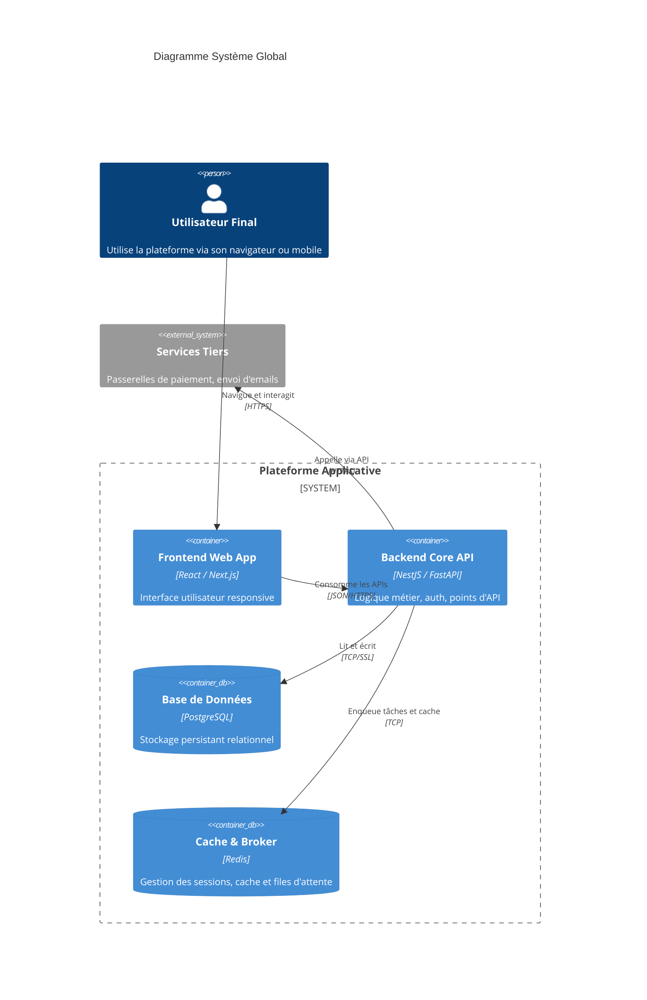

# Vue d'Ensemble du Système & Architecture

## 1. Style Architectural Global
- Modèle général : `[Ex: Monolithe Modulaire / Microservices / Serverless]`
- Frontends connectés : `[Ex: Web App (Next.js), Mobile App (React Native)]`
- Backend principal : `[Ex: API REST Node.js / NestJS ou Python / FastAPI]`
- Persistance & Caches : `[Ex: PostgreSQL + Redis]`

## 2. Diagramme C4 Mermaid (Niveau Système & Conteneurs)

## 3. Frontières et Responsabilités
- **Frontend** : Rendu visuel, capture des intentions utilisateur, validations de premier niveau, gestion de session locale.
- **Backend Core** : Garant des invariants de données, autorisations strictes, opérations transactionnelles.
- **Systèmes Externes** : Délégués uniquement pour les compétences non-core (livraison de mails, encaissement bancaire).
