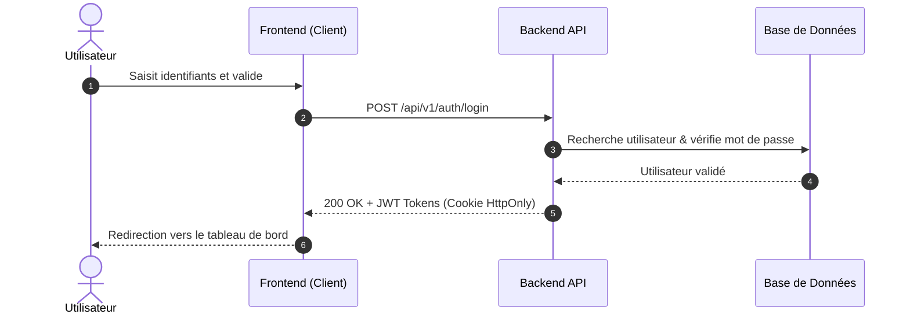
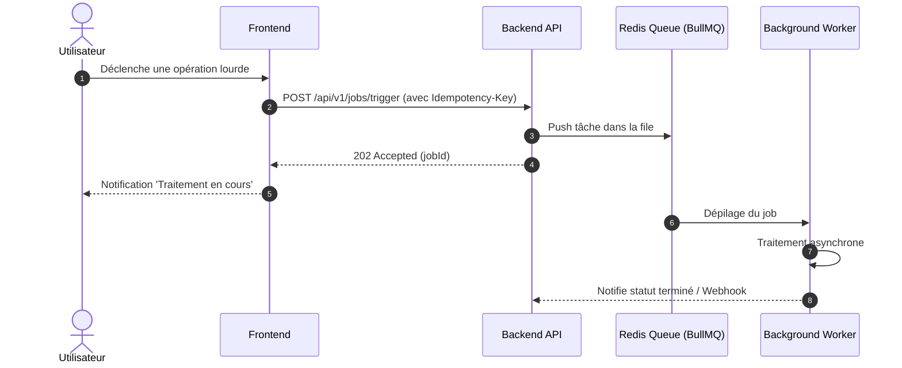

# Flux de Données & Diagrammes de Séquence

## 1. Flux Critique 1 : Authentification & Accès aux Données

## 2. Flux Critique 2 : Traitement d'une Action Métier Asynchrone

## 3. Résilience & Gestion des Pannes Réseau
- Stratégie de timeout : 10 secondes maximum par requête API synchrone.
- Circuit Breaker configuré pour isoler les services tiers défaillants sans bloquer le reste de l'application.
