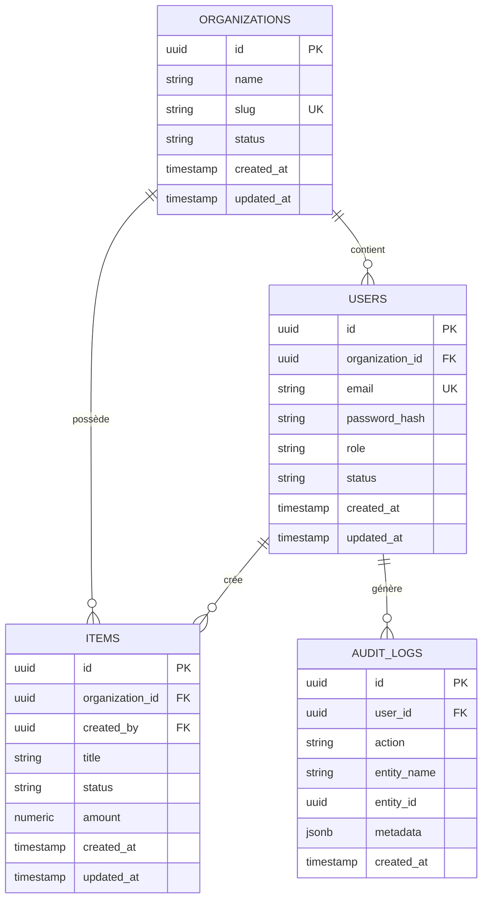

# Schéma Entité-Relation (ERD)

## 1. Diagramme Entité-Relation Mermaid

## 2. Énumérations & Dictionnaire de Données
- **Status (ORGANIZATIONS)** : `ACTIVE`, `SUSPENDED`, `TRIAL`.
- **Status (USERS)** : `PENDING_ACTIVATION`, `ACTIVE`, `BLOCKED`.
- **Roles (USERS)** : `SUPER_ADMIN`, `ADMIN`, `MEMBER`, `VIEWER`.
- **Status (ITEMS)** : `DRAFT`, `PUBLISHED`, `ARCHIVED`.
